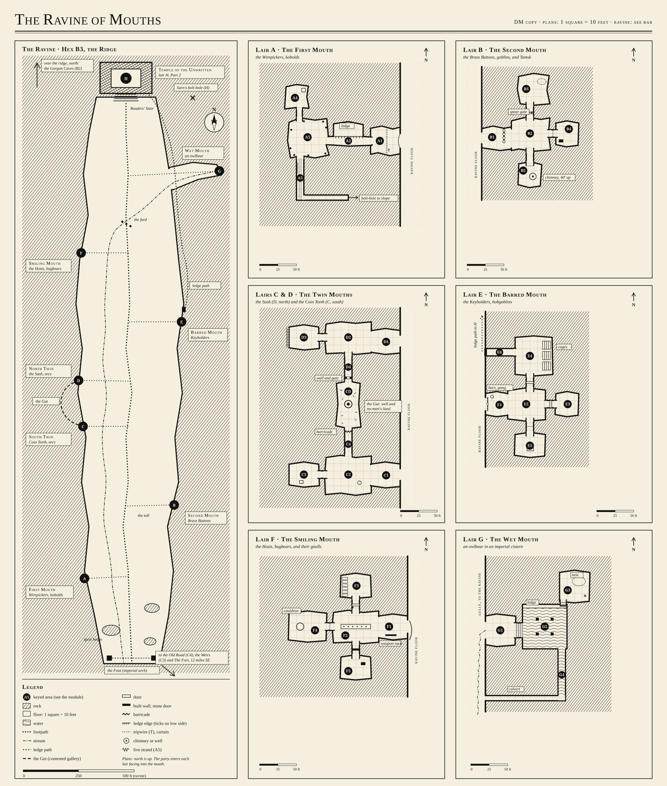

# Dungeon Master's Guide

## *Module 3, Part 1: The Ravine of Mouths*

*A B/X dungeon of clans for levels 1–3. Seven lairs in a cleft of the Ridge, climbing to the Temple of the Unwritten. Part 2, the Temple itself, is [`Module_3_Part_2_The_Temple_of_the_Unwritten.md`](Module_3_Part_2_The_Temple_of_the_Unwritten.md).*

> **Homage:** This module glosses the cave-lair ravine of module B2 (1979): a cleft of cave mouths, each the lair of a different humanoid clan, rising to an evil temple. We took that idea and that shape. All text, names, maps, room keys, people and room contents here are original, written for The Fort Country.

**Map:** [`maps/ravine_of_mouths.svg`](maps/ravine_of_mouths.svg). One sheet: the ravine overview with every mouth A–H, and floor plans of lairs A–G on a 10' grid.



---

# Part One: The Ravine and the Road

## Overview

| | |
|---|---|
| **Location** | The Ridge, hex B3. About 12 miles northwest of The Fort, by the Old Road (C4) or through the Weirs (C3). The Gorgon Caves (B2) are next door. |
| **Structure** | A footpath up a ravine floor. Seven lairs (A–G) in its walls. The Temple (H) at the head, in Part 2. |
| **Home base** | The Fort. There is no forward camp. Everything you take, you carry home. |
| **Play time** | Four to six sessions for A–G. One or two more for H. |
| **Party** | 4–7 PCs of levels 1–3, plus retainers. The Minister comes if no player plays a cleric. |
| **Difficulty** | Harder than the Caves. A fight picked badly kills people. A fight talked out of costs nothing. |

## What This Module Teaches

Module 1 taught look, talk, fight. Module 2 taught time, light and mapping: a dungeon is a place you visit more than once. This one teaches that **a dungeon is a society.** The monsters want things. They hate each other. They run, they bargain, they lie, and they remember.

| Lair | Lesson |
|------|--------|
| A, First Mouth | **Morale.** Enemies run. A first fight that ends early if you let it. A trapped entrance. |
| B, Second Mouth | **The reaction roll and parley.** The ogre can be bought. |
| C and D, the Twin Mouths | **Factions.** Two bands who hate each other. Who you help changes the map. |
| E, Barred Mouth | **Alarm and reinforcement.** The lair responds. A rescue against the clock. |
| F, Smiling Mouth | **Deception.** Read the table, not the words. |
| G, Wet Mouth | **Avoidance.** Not every lair is worth its cost. |
| *Throughout* | **Expedition supply.** Food, light, hirelings, and getting the loot home across 12 miles. |
| H, the Temple | Everything at once. Part 2. |

Every lair has an **obvious approach** that a new player can try in the first minute, and a **clever approach** that rewards an old hand. The lair box names both. Neither is wrong.

---

## What's Really Going On

The empire cut the Ridge for stone. Then it found a better use for the cut. It built a relay station at the head of the cleft and carved great faces into the walls below it, each face around the mouth of a quarry gallery. Behind every face runs a cable as thick as a man's arm. The faces are horns. The station sang the hymns down the cleft, and the horns passed the song on, down the Old Road to the humming milestone and from there across the network. A hymn is a protocol. The faces were its loudspeakers.

The empire is gone. The galleries became lairs. Six clans live in them now, and they wear the empire's scrap without knowing what it was for.

Two years ago, **the Readers of the Unwritten** took the relay station. They woke its dark Terminal and taught it to sing backwards. On still nights the horns still carry the song down the ravine, reversed. The clans hear it in their sleep. The Readers pay the clans in faceless silver and bully them with their dead.

**What the Readers want from the ravine:**

| They want | Who gets it for them | Why |
|-----------|---------------------|-----|
| Cockatrice eggs | The Coin Teeth orcs (C) carry them from the humming milestone, where the Saltmen leave them | Word is out that a cockatrice beat the Gorgon Queen next door. The Readers want stone guardians that never sleep. Eggs make stone. |
| Copper cable | The Wirepicker kobolds (A) strip it from the galleries | To mend the dark Terminal's voice |
| Living people | The Keyholder hobgoblins (E) buy and hold them; the Hosts (F) sell them guests | For the guardians. The Readers do not say this aloud. |
| Obedience | Everyone | The Readers dug up the Sash orcs' dead (D) and made them walk. Every clan saw it. |

**The Gorgon Queen.** Last year a cockatrice turned the Gorgon Queen to stone in the caves at B2. The wards there still glow; she is contained, not destroyed. Every clan on the Ridge knows the story. Kobold mothers tell it. Orcs swear by it. Nobody goes into the Gorgon Caves.

### The Clock

The Readers and the clans do not wait for the party. Count weeks from the day the party first hears the hook. If the party has broken a clan, skip that clan's entries.

| Week | What happens if the party is slow |
|------|-----------------------------------|
| 1 | The Coin Teeth raid the Weirs again. Wenna Coyle is sold to the Keyholders (E). Collector Ivo takes two eggs up to the Temple. |
| 2 | The Keyholders send their prisoners up the Collection Door (E6). **A rescue after week 2 finds the pens empty**, except for whoever was taken this week. The Sash try for the Gut and lose four orcs. |
| 3 | The Coin Teeth take the Gut. The Sash are down to six and sealed in. The first stone guardian stands in the Temple yard. Its face is a face someone at The Fort would know. |
| 4 | The Sash are gone: dead, or raiding the Fields (E4) for food. The Readers have the eggs they need. Collector Ivo and four Coin Teeth walk the Old Road toward the lake, asking about boats. |
| 5+ | The Readers turn to the Door Beneath the Lake. Part 2 says what that means. |

> **Design Note:** Tell the players about the clock in the fiction, not as a rule. Merrit Coyle counts the days his sister has been gone. Harrow mentions that the eggs are "going quicker now". The point is that waiting is a choice with a cost.

---

## The Hook

Use one or more. They all point to the Ridge.

| Hook | Who brings it | What it says |
|------|---------------|--------------|
| **New stakes at the Weirs** | Captain Maren | The Fort's old fish traps in the reeds (C3) have new stakes driven among them, and on each stake is nailed a little card of punched tin. Fish are gone from the traps. Two nights ago, Wenna Coyle went to cut withies at the Weirs and did not come back. Maren wants to know who is raiding, how many, and whether they mean to come further. |
| **The Saltmen's ledger** | Module 2 | The ledger from the grotto lists eggs "up the Old Road to the Readers, left at the hum." The hum is the humming milestone (C4). Someone collects there. |
| **The humming milestone** | Harrow, or a Fort farmer | The old milestone on the Old Road has started to hum louder at night. Bootprints with hobnails in a ring come and go from it, west toward the Ridge. |
| **Merrit Coyle** | Wenna's brother, a woodcutter | He asks the party to bring his sister home. He has nothing to pay. He will carry anything. |
| **Petra** | If Petra was saved in Module 1 | She says that while she was stone she heard singing through the rock from the next ridge over, and the words ran backward. |

### The Throughline

| From | Clue | Points to |
|------|------|-----------|
| Module 1 | A cockatrice turned the Gorgon Queen to stone. Harrow buys cockatrice eggs. | Someone wants stone. |
| Module 2 | The Saltmen leave eggs at the humming milestone for "the Readers". | The Old Road and the Ridge |
| This module | The Coin Teeth carry eggs up the ravine. The Keyholders send people up. The Readers pay for both. | The Temple (H) |
| Part 2 | The Readers' map of the island, and the dark Terminal | The Door Beneath the Lake |

---

## Intro Hooks: Where Each Character Lands

Each player arrives with three facts from their playbook: a **public fact** (their Reputation line: everyone at the table knows it), a **secret fact** (their "You start knowing" line: only they and you know it) and a **bond** (who they are tied to at The Fort).

| Fact | How you use it |
|------|----------------|
| **Public fact** | NPCs act on it. A clan that would care about it hears of it, and the first reaction roll shifts by 1 either way. |
| **Secret fact** | Place it in the room named below before play. When the player says it out loud, it is true. If they never say it, it stays hidden. |
| **Bond** | If two players' bonds name each other, use the **Mutual bonds** rule in the Fate box. |

| Playbook | Their choice | Where it lands in the ravine |
|----------|-------------|------------------------------|
| **Wizard** | Master was doing something wrong | The ancient site the master researched is this ravine. The reason it should stay sealed: "the horns carry the song both ways." Lands at **A4**, the cable Nitch has polished. |
| | Wanted power | The rumoured power is the dark Terminal. Goodman Thole has a Reader's book of reversed hymns for sale in **F5**, and he knows the Wizard will want it. |
| | Sent here, doesn't know why | The phrase the master made them memorize is painted backwards on the wall of **C2**. Read forwards, it is the same line from the Minister's hymnal. |
| **Elf Minister** | The Terminal showed a map | "One is close; one is underground." The underground one is the Temple's. It glowed on her map. It is dark now. **E6** footprints lead toward it. |
| | It showed a name | The list of names includes **Hrogg** of the Sash (D3). The Terminal was waiting for an orc. |
| | It showed a warning | The Readers want the door beneath the lake opened. The letter in **C3** and the day-book in **G3** both say so. |
| **Half-Elf Paladin** | The order disbanded | The Sash orcs (D) drill like the order's old auxiliaries. They salute the sigil on the Paladin's shield at **D1**. |
| | The order was betrayed | Collector Ivo (wandering table) wears a knight's ring of the order on his thumb, taken from a body. |
| | The order was consumed | The Keyholders (E) wear plates of order armour stamped with the screen-in-a-ring-of-eyes. Gaoler Ushk's coat at **E5** was a knight's. Inside its collar the knight who wore it last scratched a hymn line backwards: the symptom the Paladin watches for. |
| **Gnome Druid** | The land is sick | The sickness is worst at the Wet Mouth (**G1**). The spring runs sour below the cistern, and the sour comes from uphill. |
| | The land is waking | No birds nest on the Ridge. But the ferns at **G1** grow in spirals, all turning the same way, toward the head of the ravine. |
| | The land is old and remembers | The cable in **A5** is warm. The land is feeding it. The Terminal and the land are entangled here, and the Temple drinks from both. |
| **Fighter** | Forged a plow blade | Knows every family. Wenna Coyle (**E4**) has two children at The Fort and a husband who drinks. |
| | Forged the beast-pen cage | If the cage holds a goblin, it is **Snitter**'s cousin from the Brass Buttons (B). Brought along as a gift, it earns +2 on reactions at **B2**. |
| | Forged nails for coffins | The dead man was not sick. The claw marks were a bugbear's. The Hosts (F) hunt as far as the Weirs at night. |
| **Elf** | People are gone | They went west, over the Ridge. Their sign is cut small into the brow of the First Mouth (**A1**): they saw these faces carved. |
| | Was sent | "You will know when it's time." The sign: a ridge with no birds. It is time. |
| | Was cast out | Thole wears an elven ring on a cord (**F2**). It belonged to the person the Elf wronged. |
| **Minister (NPC)** | Afraid it's just a recording | At the well in the Gut (**CD**), she hears the hymn in the water, reversed. The Terminals are not just recordings. Something is answering. |
| | Afraid of new messages | The reversed line on **C2**'s wall is one of her new messages, backwards. |
| | Afraid she's the last keeper | The Temple's Terminal is a keeper's Terminal too. Someone is keeping it. |

---

## Fate at the Table

| Rule | What it does |
|------|--------------|
| **Fate Points** | Each character has 3. 1 FP: reroll an attack, damage or save. 1 FP: +4 to a save after the roll. 2 FP: cheat death and drop to 1 hp. They refill after a full rest. |
| **Fate abilities** | Prompt them *before* you describe a mouth or a room, not after. "Before I tell you what's inside: does anyone have something to declare about this face?" |
| **Mutual bonds** | If two characters' bonds name each other, each gets **1 extra Fate Point** this session. It can only be spent to help that partner: a reroll on their behalf, +4 to their save, or cheating death for them. Unspent, it is gone at session end. |
| **Awards** | 1 FP for a bold, clever or true act. In this module, reward a good parley as you would a good fight. |

---

## The Journey

The Fort is home. The Ridge is half a day away. Every trip is out and back.

| Route | Hex | What's there | Who uses it |
|-------|-----|--------------|-------------|
| **The Old Road** | C4 | A broken imperial road through forest. Halfway along stands the **humming milestone**: a stone post as tall as a man, warm to the touch, humming a note you feel in your teeth. A stone lid at its foot hides a hollow. | The Readers and their carriers. The Saltmen leave eggs in the hollow. The Coin Teeth leave faceless silver and take the eggs. |
| **The Weirs** | C3 | Reed marsh and the Fort's old fish traps. Among the old posts, new stakes, each with a punched tin card nailed on. | The clans, raiding. It is wet, slow and hidden. |

Travel time depends on the slowest walker. OSE gives miles a day as movement ÷ 5; a road is half again as fast, a marsh half as fast. Rounded:

| Slowest walker | By the Old Road | Through the Weirs |
|----------------|-----------------|-------------------|
| 120' (unarmoured) | 3 hours | 6 hours |
| 90' (leather) | 4 hours | 8 hours |
| 60' (chain, or leather and treasure) | Half a day | A full day. Camp in the reeds. |
| 30' (chain and treasure) | A full day | Two days |

> **Design Note:** The table is the lesson. A party in chain walks to the Ridge in half a day. The same party walking home with Grisk's chest takes a full day and arrives after dark. Let them see the numbers before they lift the chest.

**On the road:** check for an encounter once each way (1-in-6). On a hit, roll on the wandering monster table, using the row for the clan whose raiders use that road: the Coin Teeth (row 3) on the Old Road, the Brass Buttons (row 2) at the Weirs.

**The milestone:** each time the party passes it, roll d6. 1–2: the hollow holds two cockatrice eggs in straw, waiting. 3: it holds a bag of 100 faceless silver blanks (10 gp), waiting for the Saltmen. 4–6: empty. Taking the eggs moves the clock: the Coin Teeth come looking, and Ivo asks why.

---

## Hiring at The Fort

This module teaches hiring. The party can bring people. People cost money, need food, and can break.

**Retainers** go into the lairs, fight, and take a **half share** of treasure on top of their wage. **Hirelings** carry, guard, and take a wage only. Both eat.

| How many | Each PC may hire retainers up to their CHA limit: CHA 3 → 1, 4–5 → 2, 6–8 → 3, 9–12 → 4, 13–15 → 5, 16–17 → 6, 18 → 7. |
|---|---|
| **Hiring roll** | Offer the job, then roll 2d6 + CHA modifier. 2 or less: refuses, and The Fort hears of the insult (−1 to further hiring rolls). 3–5: refuses. 6–8: wavers; sweeten the offer and roll again. 9–11: accepts. 12+: accepts gladly, +1 loyalty. |
| **Loyalty** | Base 7, modified by the employer's CHA (3 → −3, 4–5 → −2, 6–8 → −1, 13–15 → +1, 16–17 → +2, 18 → +3). Roll 2d6 against it when the retainer faces great danger, and after each trip. Roll over: they flee, refuse, or quit. |
| **Pay** | Daily, in coin, at The Fort. A retainer not paid loses 1 loyalty for each day owed. |

### Who Will Come

All are normal humans: AC as listed, THAC0 19 [0], MV 120' (40') unless armoured, SV D14 W15 P16 B17 S18 (NM). Fill in which PC hired them.

| Name | What they do | AC, hp, weapon | Wage | Loyalty | One line |
|------|-------------|----------------|------|---------|----------|
| **Donal** | Militia spearman. Came back from the Gorgon Caves with holes in his memory. | 7 [12], 5 hp, spear 1d6 | 2 gp/day + half share | 7 | Brave in daylight. Wants to prove he isn't broken. Maren must agree to lose him off the wall. |
| **Merrit Coyle** | Woodcutter. Wenna's brother. | 9 [10], 6 hp, axe 1d6 | None, and no share | 10 while Wenna is missing; 6 after | Quiet. Will go into any cave alone if nobody else will. |
| **Ossie** | Tanner's son, fifteen. Torchbearer and porter. | 9 [10], 3 hp, dagger 1d4 | 5 sp/day | 6 | Talks without stopping. Knows two rumours (roll twice on the rumour table). |
| **Sabeth and Bracken** | Farmer and her mule. Hireling: carries and waits at the ravine foot. | 9 [10], 4 hp, staff 1d4 | 1 gp/day, both | 7 | Will not go underground. Bracken bites strangers and carries 2,000 coins. |
| **Pell** | Harrow's nephew. Knows the Old Road. | 7 [12], 4 hp, short bow 1d6 | 2 gp/day | 7; 5 near eggs or Saltmen | Charming. Tells Harrow everything. Harrow tells the Saltmen. |
| **Hale Tusker** | Fisherman. Knots, nets, rope. | 9 [10], 6 hp, gaff 1d4, net | 1 gp/day + half share | 8 | Superstitious. Will not enter the Wet Mouth. Knows the Weirs better than anyone. |

> **Design Note:** Every retainer has a hook into the ravine. Merrit wants his sister. Pell leaks. Hale knows the Weirs. Donal's broken memory comes back when he hears the reversed song. Hire them for their numbers and play them for their lines.

---

## The Expedition Sheet

*One page. Keep it beside Module 2's Dungeon Clock. Read it before the first trip; use it at every return.*

### 1. Before you leave The Fort

1. **Buy.** Harrow's shop (Module 1). Add: mule 30 gp, handcart 20 gp (holds 3,000 coins on a road, useless in the ravine), sacks 1 sp each.
2. **Hire.** Use the table above. Write each retainer's loyalty on a card.
3. **Load.** Each player says what they carry. You set their movement from the encumbrance table below.
4. **Plan the route.** Old Road or the Weirs. Fast and watched, or slow and hidden.

### 2. Encumbrance (OSE basic)

| Armour | Movement | Carrying treasure |
|--------|----------|-------------------|
| None | 120' (40') | 90' (30') |
| Leather | 90' (30') | 60' (20') |
| Chain or plate | 60' (20') | 30' (10') |

- **Carrying treasure** means more than a purse: a sack of coin, a chest, or anything the key gives a weight for.
- **Most a person can carry:** 1,600 coins of weight. A coin weighs 1 coin. The key gives heavy things in coins.
- **A mule:** 2,000 coins at full speed, 4,000 at half. It will not climb a chimney or wade a cistern.
- **The party moves at its slowest member's speed.**

### 3. Supply

| Item | Rule |
|------|------|
| **Rations** | One per person a day. Without food: no healing from rest, and −1 to hit after two days. |
| **Water** | A waterskin lasts a day. In the ravine, clean water is in the Gut's well (contested, CD) or the Wet Mouth's spring (an owlbear, G). |
| **Light** | Torch 6 turns. Lantern 24 turns a flask. (The Dungeon Clock.) |
| **Wages** | Paid at The Fort, daily. |

### 4. In the ravine

| Rule | Detail |
|------|--------|
| **Time** | Walking the path from one mouth to the next takes 1 turn. Inside a lair, use the Dungeon Clock. |
| **Wandering checks** | Every 2 turns, on the path or in a lair: 1-in-6. At night on the path: 2-in-6. Roll on the ravine's table. |
| **Camping in the ravine** | Possible. Every clan sees your fire. Two night checks at 2-in-6, and every clan that knows you hears where you sleep. |
| **The Plan / Execute gate** | At every lair mouth and every parley. See below. |

### 5. The Plan / Execute gate

Module 2 taught it. Use it hardest here, because here the monsters talk.

| Phase | What happens |
|-------|--------------|
| **Plan** | The players talk, look and ask. You answer honestly from what their characters can see and hear. No dice. No time passes. They choose who speaks, what they offer, where everyone stands, and what the signal is to run. |
| **Execute** | The caller says "Execute". Plans lock. Each player states one action. Then you roll: reaction, surprise, morale, whatever the action calls for. |
| **Acting early** | If a player acts during Plan, ask once: "Is that your plan or your action?" |

**At a lair mouth:** Plan covers the approach. Which way in, in what order, with what light, and whether anyone listens first. Execute is the first step through the teeth.

**At a parley:** Plan covers the offer. Who talks, what you give, what you will not give, and what you do if they draw steel. Execute is the first word spoken. Then you roll the reaction.

### 6. Getting home

| Rule | Detail |
|------|--------|
| **XP for treasure** | Treasure gives XP only when it is inside The Fort's palisade. Coins left in a lair, or dropped on the Old Road, give nothing. |
| **XP for monsters** | When they are defeated: killed, routed, bought off, tricked, or talked past. |
| **Shares** | One share for each PC. A half share for each retainer. Hirelings get wages, not shares. |
| **Healing** | A full day of rest at The Fort: 1d3 hp. Spells and Fate Points return after a full night's rest. |

### 7. Between trips: the checklist

1. Count food, light, water and hp.
2. Pay retainers. Roll loyalty for any who saw a death, went unpaid, or were left behind.
3. Advance the Clock by the days that passed.
4. Roll or choose on **The Ravine Reacts** for each clan the party touched.
5. Ask what The Fort sees them bring home (**The Fort Reacts**).

---

# Part Two: How Monsters Behave

## The Reaction Roll

When the party meets monsters who are not already fighting, roll 2d6 to see how they take it. Roll in the open the first few times so the players learn that talking is a move.

**When to roll:** at the first meeting, after the Execute call, when the party's speaker says their first words or does their first thing.

| 2d6 + mods | Result | What the monsters do |
|------------|--------|---------------------|
| 2 or less | **Attack** | They fight now. |
| 3–5 | **Hostile** | They threaten, demand, and may attack. One more wrong step and they will. |
| 6–8 | **Uncertain** | They wait and watch. They can be swayed. Roll again after the next offer. |
| 9–11 | **Willing to talk** | No attack. They listen to offers and make their own. |
| 12 or more | **Friendly** | They help, as far as their nature allows. A goblin's help is still a goblin's. |

**Modifiers in the ravine:**

| Situation | Mod |
|-----------|-----|
| The speaker's CHA modifier | as OSE |
| Speaks the clan's language | +1 |
| A gift they value (food, salt, coin, meat for the ogre) | +1 |
| Shows a Readers' tin card | +2 with A, B, C, E, F. −2 with D. |
| The party has killed this clan's people | −2 |
| The party helped this clan's enemy | −2 |
| The party helped this clan | +2 |
| The party's public fact matters to this clan (Intro Hooks) | ±1 |

**Worked example 1: the toll.** At B1, two goblins rise over their shield wall and shout "Toll!" The players plan: the Wizard speaks, the Fighter keeps a hand off her sword, and they will offer six silver. "Execute." The Wizard (CHA 9, +0) holds up the coins (+1, a gift). You roll 3 and 4: 7, +1 is 8. **Uncertain.** The goblins take the silver, say "Wait," and one runs inside. That is not a fight and not a friendship. It is a door half open. If the party offers more, roll again.

**Worked example 2: the salute.** At D1, the Paladin (CHA 14, +1) steps forward and lifts her shield so the sigil shows. You decide the Sash know that sign: it is the order their ancestors served beside (+1, public fact). You roll 2 and 5: 7, +2 is 9. **Willing to talk.** The sentries ground their spears and one goes to fetch Hrogg.

**Worked example 3: the lie.** At F1, the bugbear doorman always *acts* friendly. That is not his reaction; that is his trap. Roll his real reaction behind the screen. On 9 or more, he is truly open to a deal if the party shows teeth. On 8 or less, the welcome is bait. Play both the same until the party reads the tells.

---

## Morale

Monsters are not robots. Most want to live. Morale decides when they stop fighting.

**When to check:**

1. When the first of their side is killed.
2. When half of their side is dead, down or fled.
3. When their leader falls (always, whatever the count).

**How:** roll 2d6 against the monster's **ML**. Roll **over** ML and they break. Roll equal or under and they fight on. A group that passes twice in one fight fights to the end. ML 12 never checks. ML 2 never fights.

**Breaking** means they flee if they have somewhere to go and surrender if they do not. A surrendered monster is a source of information, a prisoner to feed, or a moral problem. All three are interesting.

| Situation | ML mod |
|-----------|--------|
| Defending their own young or hoard | +1 |
| Their leader in sight | as the lair says |
| Their leader just fell | as the lair says, or −2 |
| Unpaid hirelings (Tamsk, the gnolls) | −2 |
| Facing something they fear (fire for the owlbear; the Readers' dead for anyone) | −2 |

**Worked example 1: the ledge.** At A2, six kobolds sling stones from a ledge. The Elf's arrow kills one. That is the first death: check. Kobold ML is 6. You roll 4 and 4: 8. Over 6: they break. They drop off the back of the ledge and run for the warren, shrieking. The fight lasted one round. Ask: "Do you chase them?"

**Worked example 2: the leader.** In C2, the Fighter cuts down Gorm, the Coin Teeth's band leader. The leader fell: check. Orc ML is 8, but when their leader falls it drops to 6. You roll 3 and 2: 5. They hold. Later, half of them are down: check again at 6. You roll 6 and 3: 9. They break and run north to the barricade.

**Worked example 3: the ogre.** Tamsk is ML 10, but he is unpaid (−2): 8. The first time he is hit hard, check. If he breaks, he does not run. He sits down and says, "Not for no goats."

**Retainers check too.** Use their loyalty as their ML. A retainer who breaks runs back to The Fort, and The Fort hears why.

---

## The Faction Web

| Clan | Wants | Fears | Hates | Will trade | Knows about the Temple |
|------|-------|-------|-------|------------|------------------------|
| **A. Wirepickers** (kobolds) | To sell cable without paying the goblin toll | Everything bigger; the owlbear; the Gorgon Caves | The Brass Buttons (the toll) | A safe way past B; their bolt-hole; how their trap works | The Readers buy cable "to mend the singing box's mouth". A Reader came once, touched Nitch's polished cable, and wept. |
| **B. Brass Buttons** (goblins) | Toll; buttons; Tamsk paid or gone; the Sash to stop raiding her toll | Tamsk's temper; the Hosts | The Sash; the Wirepickers (won't pay) | Passage; her toll-sticks, a record of who goes up and down and when | The Collector comes down at the dark of the moon in a chair carried by two dead men. |
| **C. Coin Teeth** (orcs) | The Gut's well; the Sash wiped out; more silver | The Readers' dead; losing the Readers' pay | The Sash | The Sash's chest (promised, not theirs to give); an escort on the Old Road | Eggs go up to "the House". The Readers pay in faceless silver. The Collector's name is Ivo. |
| **D. The Sash** (orcs) | Their dead back in the ground; Vashka's head; the well | Being wiped out; they are fewer | The Coin Teeth; the Readers | Six spears to march on the Temple; drill | The Readers took twelve bodies from the Sash's niches. At dusk the dead walk in a line around the Temple yard, carrying stones. |
| **E. Keyholders** (hobgoblins) | Captives at good prices; order | The Readers stopping payment | Nobody. It is business. They despise goblins. | The prisoners, at a price; their ledger | Thirty-one captives sent up the ledge path by the Collection Door in two years. None came back down. |
| **F. The Hosts** (bugbears) | Guests; meat; to be admired | The owlbear; what the Readers do with the living | The Sash (Hrogg knows the Hosts ate a patrol) | Information, mixed true and false, for a price | The Readers pay thirty silver for each living guest. "They want them for the yard. Not for supper. I asked." |
| **G. The owlbear** | Food, water, sleep | Fire | Anything in its water | Nothing | It ate a Reader. Her day-book is in its den. |

**The web in one look:**

```
                      [H] THE READERS
          pay ---------/   |   |   \--------- buy people
         /        pay /    |   |pay \              \
      [A]--toll-->[B]     [C]  |     [E] keeps --> up the ledge path to [H]
   kobolds  goblins+     Coin  |   hobgoblins
            Tamsk(unpaid) Teeth|
                           \   |
                     the Gut (well) ===== WAR ===== [D] the Sash
                                                   (dead stolen by [H])
      [F] the Hosts --sell guests--> [H]       [G] owlbear: fears none,
          gnolls (unpaid)                          eats anyone
```

> **Design Note:** Every clan has a grudge and a price. When the players are stuck, ask them what the last clan they met wanted. The answer is usually the key to the next lair.

---

# Part Three: The Ravine

## The Ravine Path

The cleft is about half a mile long, 300 to 500 feet wide, with walls 80 to 150 feet high. A stream runs down it from the Wet Mouth. The footpath climbs beside the stream from the Foot at the south end, the end nearest The Fort, to the Temple at the north end. Nothing grows above knee height. No birds.

| Place on the path | What's there |
|-------------------|--------------|
| **The Foot** | An imperial arch over the path, its keystone carved with a face whose mouth is stopped by a carved hand. Both roads from The Fort meet here. Sabeth and Bracken wait here, if hired. |
| **The Spoil Heaps** | Grey rubble mounds from the quarry. Good cover. Giant rats. |
| **The Toll** | Where the Brass Buttons stop travellers, below B. |
| **The Ford** | The Wet Mouth's stream crosses the path on stepping stones. |
| **The Ledge Path** | Cut along the east wall from the Barred Mouth (E6) up to the Temple's lower yard. Three feet wide. |
| **The Readers' Stair** | Cut steps at the head of the ravine, up to the Temple. |

> **Read aloud (at the Foot):** The ravine opens in the Ridge like a cut in bread, and its walls are full of faces. Each is as tall as a house and carved around a cave: one grins, one shouts, two lean together as if arguing, one smiles. Nothing sings here, no bird, no insect. Then the wind turns, and from somewhere high up the cleft comes a long low note, like a hymn sung by someone breathing in.

> **Art reference:** The whole cleft in one long vertical panel, Otus ink, black on cream. Faces cut into both walls, stippled shadow in their open mouths, the path a thin white thread up the middle. At the top, a squat dark building half sunk in the hill.

---

## Wandering Monsters

Check every 2 turns in the ravine and in the lairs (1-in-6), and twice a night if the party camps (2-in-6). Roll d8. Read the column that matches that clan's state now. A clan is **broken** when its leader is dead or more than half its number gone.

| d8 | Clan | If the clan holds | If the clan is broken | If allied with the party |
|----|------|-------------------|----------------------|--------------------------|
| 1 | Wirepickers | 1d4+2 kobolds hauling cable down to the toll. They drop it and run (ML 6). | 1d3 kobolds begging for food | A kobold runner with news: tell the party one line from The Ravine Reacts |
| 2 | Brass Buttons | 1d6+2 goblins collecting toll | Tamsk, hungry and alone (if alive and unbought); else 1d4 goblins looting | Goblins selling smoked fish, 1 sp a fish |
| 3 | Coin Teeth | 1d4+2 orcs with a sack, back from the Old Road | 1d3 deserters with silver, heading for the Weirs | An escort to the next mouth |
| 4 | The Sash | 1d4+2 orcs in step, patrolling | One orc with a red band, alone, wanting to die well. Attacks any Coin Tooth on sight. | A patrol that salutes |
| 5 | Keyholders | 3 hobgoblins with a captive on a rope, walking up to E | A loose wolf (from E3), or an escaped captive | (The Keyholders do not ally. Treat as "holds", but they offer to buy the party's prisoners.) |
| 6 | The Hosts | 2 gnolls pushing a handcart of boots | 1d4 unpaid gnolls, raiding anyone | Thole's doorman with an invitation to dinner. Still a trap, unless the deal was real. |
| 7 | The Readers | **Collector Ivo**, 2 acolytes and 2 skeletons carrying his chair. If two or more clans are broken, he brings 4 skeletons and asks the party to tea. | — | — |
| 8 | Beasts | By day: 1d6 giant rats from the spoil heaps. By night: the owlbear, if G was disturbed and it lives. | (G dead or gone: 1d4 wolves come down from the Ridge to the empty den) | — |

**Collector Ivo** is a soft-voiced man in grey with a hand-drum at his belt. He is polite, curious and in no hurry. He asks the party's names and writes them down. He pays any clan anything for news of them.

**Stat blocks for the wandering table:**

*Kobolds, goblins, orcs, hobgoblins, gnolls, wolves: as in their lairs.*

**Collector Ivo** (Reader, Cleric 2; one spell: *Darkness*, the reverse of *Light*)

| AC | HD (hp) | Att | THAC0 | MV | SV | ML | XP |
|----|---------|-----|-------|----|----|----|----|
| 9 [10] | 2 (9) | 1 × mace (1d6) | 19 [0] | 120' (40') | D11 W12 P14 B16 S15 (C2) | 8 | 25 |

**Reader acolytes ×2**

| AC | HD (hp) | Att | THAC0 | MV | SV | ML | XP |
|----|---------|-----|-------|----|----|----|----|
| 9 [10] | 1 (4, 3) | 1 × club (1d4) | 19 [0] | 120' (40') | D11 W12 P14 B16 S15 (C1) | 7 | 10 each |

**Skeletons ×2 (or ×4)** — the Sash's dead, red rags on their bones

| AC | HD (hp) | Att | THAC0 | MV | SV | ML | XP |
|----|---------|-----|-------|----|----|----|----|
| 7 [12] | 1 (5, 4, 6, 3) | 1 × weapon (1d6) | 19 [0] | 60' (20') | D12 W13 P14 B15 S16 (F1) | 12 | 10 each |

**Giant rats ×1d6**

| AC | HD (hp) | Att | THAC0 | MV | SV | ML | XP |
|----|---------|-----|-------|----|----|----|----|
| 7 [12] | ½ (2, 3, 1, 4, 2, 3) | 1 × bite (1d3 + disease) | 19 [0] | 120' (40') | D12 W13 P14 B15 S16 (F1) | 8 | 6 each |

---

## Rumours

Roll d10 for each PC before the first trip. Ossie knows two.

| d10 | Rumour | Truth |
|-----|--------|-------|
| 1 | "The raiders at the Weirs wear boots with hobnails set in a ring. Orc boots, made from imperial soldiers' boots." | **True.** The Coin Teeth. |
| 2 | "The goblins on the Ridge charge a toll. Pay it and they're as harmless as a ferryman." | **Partly.** True, but Grisk also sends paying travellers to the Hosts for a cut. |
| 3 | "There's a kind of inn up there. Big furry folk keep it. Good beds, hot stew." | **False.** It is a larder with a lantern. |
| 4 | "The Readers pay in silver with no face on it. Harrow won't take it. Says a coin with no face is a coin with no master." | **True.** |
| 5 | "Wenna Coyle ran off with a smuggler." | **Partly.** She is with a smuggler: both are in the Keyholders' pens. |
| 6 | "There's a dragon in the wet cave at the top of the Ridge." | **False.** It is an owlbear. At level 1 that is not much better. |
| 7 | "The milestone on the Old Road is hollow at the foot. Smugglers leave things in it." | **True.** |
| 8 | "The orcs up there are two tribes fighting over a woman." | **Partly.** Two bands. They fight over a well, and over silver. |
| 9 | "The Readers are healers. They take the sick up the hill and cure them." | **False.** The Readers say this themselves. |
| 10 | "On still nights the Ridge sings, and the words run backwards. The Gorgon Queen hears it in her stone." | **True**, as far as anyone can tell. |

---

# Part Four: The Lairs

*Each lair opens with a box: who lives there, how many, who leads, what happens when the alarm goes up, and the two ways in. Areas follow in the house format. Turtle calls give the layout relative to the party's facing as they enter; read them as the party moves.*

---

## Lair A: The First Mouth

| | |
|---|---|
| **Clan** | **The Wirepickers.** Kobolds. They strip copper cable from behind the walls and sell it up the ravine to the Readers. They wear lamp-glass, tin and coils of wire as jewellery. |
| **Numbers** | 12 warriors, 2 bodyguards, Old Nitch. 8 old and young who do not fight. |
| **Leader** | **Old Nitch**, chieftain. Blind in one eye. Wears a round of imperial lens-glass on a cord over the other. |
| **Alarm** | The tripwire in A1 rattles pots in A2 and A3. Warriors man the ledge in A2 in 2 rounds. The old and young leave by the bolt-hole in A5 in 1 turn. |
| **Morale** | 6. Check at the first death in each group. If Nitch falls, every kobold flees. |
| **Obvious approach** | Walk in and fight. The trap springs, the ledge slings, one or two kobolds die, and the rest run. |
| **Clever approach** | Find the tripwire, step over it, and reach Nitch before the warriors wake. Or find the bolt-hole on the slope and come in from behind. Or bring something to sell. |
| **Treasure** | 147 gp. Most of it is heavy: nearly 1,400 coins of weight. |

> **Art reference:** A giant stone grin with square teeth, and in the dark between the teeth a hundred small yellow eyes. Otus ink, black on cream; the eyes are the only white. Coils of wire hang from the teeth like weed.

### A1: The Grinning Mouth

| | |
|---|---|
| **Size** | 40' × 30', rough floor |
| **Light** | Daylight for 20', then dark |
| **Exits** | East to the ravine path. West to A2. |
| **Encounter** | Tripwire and deadfall |

> **Read aloud:** The cliff has been carved into a face as tall as three men, lips drawn back from square stone teeth, and the cave is the open grin. Small bare footprints, hundreds of them, go in and out between the teeth. Something has been at the teeth with chisels, and the marks shine green.

> **Turtle call:** You face west, into the grin. The cave runs forty feet ahead and narrows to a throat. Walls close on both sides.

| Feature | Detail |
|---------|--------|
| Tripwire | Green copper wire at ankle height, 20' in. A PC who says they look at the floor for wire or string finds it. Anyone else: 1-in-6, or Find Traps. |
| Deadfall | A net of quarry stones over the throat. If the wire is tripped, the first two in the marching order take 1d6 each. Save vs. Paralysis to jump clear. The pots in A2 and A3 rattle: alarm. |
| The teeth | Chiselled to get at the cable behind them. One tooth is cut through: the cable inside is a braid of copper as thick as an arm, wrapped in rotten black skin. |
| Footprints | Kobold, many. Among them, hobnailed boots with nails in a ring: the Coin Teeth come here to buy cable. |

> **What This Room Teaches:** Look before you walk. A trap is the lair's doorbell. Disarm it and the lair is not ready for you.

### A2: The Throat

| | |
|---|---|
| **Size** | 60' passage, 10' wide. A ledge 40' × 20' runs along its north side, 10' up. |
| **Light** | Dark. Kobolds see 90' in the dark. |
| **Exits** | East to A1. West to A3. The ledge is reached by a knotted rope (the kobolds pull it up) or a 10' climb. |
| **Encounter** | 6 kobold warriors. On the ledge with slings if the alarm went; asleep on the ledge if not. |

> **Read aloud:** The passage narrows to a throat ten feet wide and the roof comes down. A shelf of rock runs along one wall at head height, its edge lined with stacked stones and broken pots. The air smells of wet dog and hot copper.

> **Turtle call:** Forward sixty feet, straight. The ledge is on your right, head height, for forty feet. At the end the passage opens out ahead.

| Feature | Detail |
|---------|--------|
| Ledge | Kobolds on it have cover: −2 to hit them from below. Climbing takes 1 round, during which the climber cannot fight. |
| Rope | Knotted. Kobolds haul it up when alarmed. A PC who reaches the ledge and drops it gives the party a way up. |
| Pots | The alarm. If they rattle, every kobold in A3 and A4 knows. |

**Kobolds ×6**

| AC | HD (hp) | Att | THAC0 | MV | SV | ML | XP |
|----|---------|-----|-------|----|----|----|----|
| 7 [12] | ½ (3, 2, 4, 1, 3, 4) | 1 × sling or spear (1d4) | 19 [0] | 60' (20') | D14 W15 P16 B17 S18 (NM) | 6 | 5 each |

When the first kobold drops, check morale. On a break, they slide off the back of the ledge and run for A3, shrieking.

> **What This Room Teaches:** Morale. Kill one and watch the rest. You do not have to finish every fight.

> **Design Note:** New players expect to kill everything. Let them watch the kobolds run. Then ask: "Do you chase them?" Chasing into a four-foot warren is a choice with a cost.

### A3: The Warren

| | |
|---|---|
| **Size** | 50' × 50', ceiling 4' high |
| **Light** | One smoking tallow lamp |
| **Exits** | East to A2. North to A4 (a 3'-high tunnel). South to A5 (a square imperial doorway). |
| **Encounter** | 6 kobold warriors, 8 old and young |

> **Read aloud:** You must crouch. The floor is a mat of rag nests and coiled wire, and the walls are pocked with holes the width of a child's body. In the lamplight eyes shine from the holes, more eyes than there are kobolds.

> **Turtle call:** The cave opens ahead and to both sides. On your right, a low black tunnel. On your left, a doorway cut perfectly square, the only straight line in the place.

| Feature | Detail |
|---------|--------|
| Low ceiling | Humans and elves fight stooped: −1 to hit, no two-handed weapons. A gnome fights normally. |
| The holes | The old and young hide here. A hand thrust in is bitten (1 hp). They come out to surrender if the warriors break. |
| Wire coils | Six coils of stripped cable, 100 coins of weight each, 5 gp each to the Readers or to Harrow. |
| Salt | Two sacks of grey salt, the Readers' last payment. 100 coins of weight each, 5 gp each. |
| Tin card | Nailed over the north tunnel: a strip of tin punched with rows of holes. A Readers' card. A hymn line written for a machine to read, backwards. |

**Kobolds ×6**

| AC | HD (hp) | Att | THAC0 | MV | SV | ML | XP |
|----|---------|-----|-------|----|----|----|----|
| 7 [12] | ½ (2, 2, 3, 1, 4, 3) | 1 × spear (1d4) | 19 [0] | 60' (20') | D14 W15 P16 B17 S18 (NM) | 6 | 5 each |

**Surrender.** Kobolds who break with nowhere to run throw down their spears and grovel. They will tell what they know (the Faction Web) to anyone who promises not to hand them to the Hosts.

> **What This Room Teaches:** Surrender is a morale result too. A beaten enemy is a source.

### A4: Old Nitch's Hole

| | |
|---|---|
| **Size** | 30' × 30', ceiling 5' |
| **Light** | Candle stubs on a flat stone |
| **Exits** | South to A3. |
| **Encounter** | Old Nitch and 2 bodyguards |

> **Read aloud:** An old kobold sits on a drum of riveted bronze, a round of thick glass hung over one eye. Behind him the wall has been picked open to show the great cable, green with age, and he has polished one patch of it until it shines like a pot. He lays his hand flat on it and says, "Listen. It is singing the wrong way round."

> **Turtle call:** The tunnel ends. The room is ahead. No other way out.

| Feature | Detail |
|---------|--------|
| The bronze drum | An imperial junction box, its lid hammered shut. Inside: 400 cp, 180 sp, and a silver whistle (25 gp). 581 coins of weight. |
| The lens | Nitch's eyeglass. Imperial lens-glass, flawless. 60 gp. |
| The cable | Warm. A hand on it feels the reversed song as a tremble. Nitch listens to it all night. |
| Nitch's deal | He wants the goblin toll gone. He offers the bolt-hole, the trap, and his knowledge of the Readers. He will not leave the cable. |

**Old Nitch** (fights as HD 2)

| AC | HD (hp) | Att | THAC0 | MV | SV | ML | XP |
|----|---------|-----|-------|----|----|----|----|
| 6 [13] | 2 (9) | 1 × hooked spear (1d6) | 18 [+1] | 60' (20') | D12 W13 P14 B15 S16 (F2) | 8 | 20 |

**Bodyguards ×2** (fight as HD 1+1)

| AC | HD (hp) | Att | THAC0 | MV | SV | ML | XP |
|----|---------|-----|-------|----|----|----|----|
| 6 [13] | 1+1 (6, 5) | 1 × weapon (1d6) | 18 [+1] | 60' (20') | D12 W13 P14 B15 S16 (F1) | 7 | 15 each |

> **What This Room Teaches:** The leader holds the clan together. A leader can also be talked to.

### A5: The Cable Gallery

| | |
|---|---|
| **Size** | 10' × 60' straight gallery, then a 3'-high crawl 60' long |
| **Light** | None |
| **Exits** | North to A3. The crawl runs east to the bolt-hole, which opens on the ravine slope 30' above the path, behind a thornbush. |
| **Encounter** | One live strand |

> **Read aloud:** The walls here are cut square and smooth, and two lines of rusted iron run along the floor. One wall has been broken open its whole length, and a trough of green copper strands spills out of it like hair from a split pillow. Somewhere in the strands, something ticks.

> **Turtle call:** Forward, straight, sixty feet. At the end the gallery stops at a wall, and a crawl-hole opens on your left.

| Feature | Detail |
|---------|--------|
| Rails | Imperial quarry rails. A rusted cart lies on its side. |
| The live strand | One strand in the trough still carries the station's current. Touching it with bare metal: 1d4 damage, save vs. Paralysis or drop what you hold. Kobolds wear rag mittens. |
| The crawl | Single file. No shields, no spears longer than 6'. Fleeing kobolds use it. |
| Bolt-hole | Opens behind a thornbush on the slope. Seen from the path only if someone searches the slope. A back door into the lair. |

> **What This Room Teaches:** Enemies run somewhere. Find where, and you find the back door.

> **Design Note:** The live strand is the ravine's first piece of working imperial machinery. Let the Wizard and the Elf Minister argue about whether it is a spell or a pipe. Both are right.

---

## Lair B: The Second Mouth

| | |
|---|---|
| **Clan** | **The Brass Buttons.** Goblins. They wear imperial uniform buttons sewn in rows on everything. More buttons, more rank. They keep a toll on the ravine path. |
| **Numbers** | 14 goblins, 2 bodyguards, Mother Grisk. **Tamsk**, an ogre, hired. |
| **Leader** | **Mother Grisk**, who wears two hundred buttons on her coat and sits in a gilded imperial sedan chair. |
| **Alarm** | The watchers in B1 bang the shield wall. B2's goblins arm in 1 round. Grisk sends a runner to wake Tamsk: 2 rounds to wake, 2 more to arrive. |
| **Morale** | 7. 9 while Grisk is alive and in sight. Tamsk: 10, but 8 while unpaid. |
| **Obvious approach** | Pay the toll, or refuse it and fight. |
| **Clever approach** | Talk to Grisk, learn that Tamsk is unpaid, and buy the ogre. Or bring Nitch's offer, or a captured Sash orc, and sell it. |
| **Treasure** | 910 gp, 300 of it in Tamsk's sack |

> **Art reference:** A shouting face with puffed cheeks, and behind its round mouth a wall of painted shields. Over the wall, small heads glittering with buttons. Otus ink on cream; the buttons are tiny white dots, hundreds of them.

### B1: The Toll Step

| | |
|---|---|
| **Size** | 40' × 30' |
| **Light** | Daylight at the mouth. A small fire behind the shield wall. |
| **Exits** | West to the ravine path. East to B2, through a gap in the shield wall. |
| **Encounter** | 2 goblin watchers behind the shield wall |

> **Read aloud:** This face has puffed cheeks, as if blowing a horn, and its open lips make a round arch. Inside, a wall of old shields stands across the cave, each painted with the same faded tower. Two small heads rise over it, bright with brass, and one calls in bad Common: "Toll! Toll for path! You pay, you walk."

> **Turtle call:** You face east, into the round mouth. Twenty feet ahead, the shield wall, waist high, wall to wall. A gap at its right end.

| Feature | Detail |
|---------|--------|
| The toll | 1 gp a head, or a sack of food. Paying gives +2 on reactions in B2, and a day's free walking on the path. |
| Shield wall | 4' high. Cover for the goblins: −2 to hit them with missiles. |
| Toll pot | A clay pot behind the wall: 150 sp (15 gp). |
| The watchers | Roll their reaction here. This is the parley lesson. |

**Goblins ×2**

| AC | HD (hp) | Att | THAC0 | MV | SV | ML | XP |
|----|---------|-----|-------|----|----|----|----|
| 6 [13] | 1-1 (4, 6) | 1 × weapon (1d6) | 19 [0] | 60' (20') | D14 W15 P16 B17 S18 (NM) | 7 (9) | 5 each |

> **What This Room Teaches:** The reaction roll. Monsters talk before they fight, if you let them.

> **Design Note:** Roll this one in the open. Then show the table how much a gift or a word would have changed it.

### B2: The Button Hall

| | |
|---|---|
| **Size** | 50' × 40' |
| **Light** | Two fires, smoky |
| **Exits** | West to B1. North to B3 (a gate of lashed spears). East to B4 (a sacking curtain). South to B5 (a low arch; smoke drifts out). |
| **Encounter** | 8 goblins, Mother Grisk, 2 bodyguards |

> **Read aloud:** Goblins squat around two fires, playing some game with brass buttons, and the clatter stops when you come in. At the far end, on a gilded chair with carrying poles, sits a goblin so covered in buttons that she chimes when she breathes. She smiles with every tooth she has and says, "Customers."

> **Turtle call:** The hall opens ahead. On your left, a gate of lashed spears. Straight ahead, past the chair, a sacking curtain. On your right, a low arch breathing smoke.

| Feature | Detail |
|---------|--------|
| Button game | A PC can join. Win or lose 1d6 gp. Losing gracefully: +1 on Grisk's reaction. |
| Grisk's chair | Imperial sedan chair, gilt. Too heavy to steal (800 coins, two carriers). |
| Grisk's buttons | Imperial uniform buttons. Each has a tiny glass eye in its centre: a badge the old station's doors once read. They open nothing now. The goblins don't know they ever did. |
| What Grisk wants | 1. Tamsk paid or gone: she owes him three goats. 2. The Sash to stop raiding her toll. 3. The Wirepickers to pay. |
| What Grisk offers | Free passage. Her toll-sticks (who goes up and down, and when). Directions to the Hosts: "Nice folk, the big ones. Go and eat with them." She is lying; she gets a cut. |

**Goblins ×8**

| AC | HD (hp) | Att | THAC0 | MV | SV | ML | XP |
|----|---------|-----|-------|----|----|----|----|
| 6 [13] | 1-1 (2, 5, 1, 3, 7, 4, 2, 5) | 1 × weapon (1d6) | 19 [0] | 60' (20') | D14 W15 P16 B17 S18 (NM) | 7 (9) | 5 each |

**Mother Grisk** (fights as HD 3)

| AC | HD (hp) | Att | THAC0 | MV | SV | ML | XP |
|----|---------|-----|-------|----|----|----|----|
| 6 [13] | 3 (15) | 1 × hooked knife (1d6+1) | 17 [+2] | 60' (20') | D12 W13 P14 B15 S16 (F3) | 9 | 35 |

**Bodyguards ×2**

| AC | HD (hp) | Att | THAC0 | MV | SV | ML | XP |
|----|---------|-----|-------|----|----|----|----|
| 6 [13] | 2 (9, 7) | 1 × weapon (1d6) | 18 [+1] | 60' (20') | D12 W13 P14 B15 S16 (F2) | 9 | 20 each |

> **What This Room Teaches:** Parley has a price, and both sides know it. A leader who talks has something to sell.

### B3: The Ogre's Pen

| | |
|---|---|
| **Size** | 40' × 40' |
| **Light** | None |
| **Exits** | South to B2, through the spear gate. Tamsk could break it. He hasn't yet. |
| **Encounter** | Tamsk the ogre |

> **Read aloud:** The cave stinks of old meat. A heap of sacking and goat hides rises and falls in the dark, and then it sits up, and it is a man twice your height with a face like a dropped pie. "Is it goats?" it says. "Tell me it is goats."

> **Turtle call:** Through the gate, the cave opens ahead and to the right. The heap is in the far right corner.

| Feature | Detail |
|---------|--------|
| Tamsk's deal | Grisk hired him for a goat a week. She owes three. For 3 goats, or 50 gp to buy them, he switches sides. For 100 gp he walks with the party for a week as a retainer: loyalty 8 while fed. |
| His sack | 300 gp in mixed coin and a brass ear-trumpet he thinks is a cup. He fights to keep it. 300 coins of weight. |
| The spear gate | Lashed spears. One round to cut through. Tamsk can break it in one blow if angry. |

**Tamsk, ogre**

| AC | HD (hp) | Att | THAC0 | MV | SV | ML | XP |
|----|---------|-----|-------|----|----|----|----|
| 5 [14] | 4+1 (26) | 1 × club (1d10) | 15 [+4] | 90' (30') | D10 W11 P12 B13 S14 (F4) | 10 (8 unpaid) | 125 |

> **What This Room Teaches:** An enemy's ally is for sale if the enemy is a bad employer. Look at who isn't being paid.

> **Design Note:** Tamsk is the biggest single fight a 1st-level party can find here. Ask the players what he wants before the dice come out. *Sleep* can drop him (he is 4+1 HD). If they buy him, let the goblins see it. Buying Tamsk costs the party his 300 gp sack, and saves their lives. That is the trade.

### B4: Grisk's Store

| | |
|---|---|
| **Size** | 30' × 30' |
| **Light** | None |
| **Exits** | West to B2, through the curtain. |
| **Encounter** | None. One goblin child hides in the cloth. |

> **Read aloud:** Bolts of cloth, sacks of dried fish and crates with broken lids are piled to the roof, and someone has sorted all of it by colour. In the middle stands an iron-bound chest with a padlock shaped like a frog.

> **Turtle call:** A dead end. Everything is here, piled around you.

| Feature | Detail |
|---------|--------|
| Cloth | Three bolts of good wool from a Fort cart: 15 gp each, 100 coins of weight each. |
| Fish | Dried fish wrapped in Harrow's own marked cloth. He will want to know. |
| The chest | Locked; the key is on Grisk's coat. Inside: 2,000 sp and 250 gp (450 gp, **2,250 coins of weight**), and a jade frog (100 gp). |
| Toll-sticks | A bundle of notched sticks. Read with Grisk's help, they tell who went up the ravine and when: Ivo every dark of the moon, hobgoblins with captives every few days, Coin Teeth with crates. |

> **What This Room Teaches:** Treasure has weight. Count the coins before you lift them. The chest alone is more than one person can carry.

### B5: The Smoke Hole

| | |
|---|---|
| **Size** | 30' × 30' |
| **Light** | A low fire under racks of fish |
| **Exits** | North to B2. A chimney climbs 40' to a crack on the ravine slope (climbing, easier with a rope). |
| **Encounter** | 4 goblins smoking fish |

> **Read aloud:** Racks of split fish hang over a low fire, and the smoke climbs through a crack in the roof as straight as a rope. Ladders of lashed bones go up into it.

> **Turtle call:** Through the arch, the room is ahead. The chimney is straight up, over the fire.

| Feature | Detail |
|---------|--------|
| Fish | Food for 10 people for 3 days. On an expedition, that is treasure. |
| Chimney | Goblins climb it at full speed. PCs at half. In the smoke, infravision fails. |
| Bone ladders | Hold a goblin. Break under anyone heavier than a gnome. |

**Goblins ×4**

| AC | HD (hp) | Att | THAC0 | MV | SV | ML | XP |
|----|---------|-----|-------|----|----|----|----|
| 6 [13] | 1-1 (3, 6, 1, 4) | 1 × knife (1d6) | 19 [0] | 60' (20') | D14 W15 P16 B17 S18 (NM) | 7 (9) | 5 each |

> **What This Room Teaches:** Food is treasure when you are 12 miles from home. And every lair has a second way out.

---

## Lairs C and D: The Twin Mouths

Two faces are carved side by side on the west wall, leaning toward each other as if caught mid-argument. Behind them live two bands of one orc clan. Two winters ago the Readers came with silver. **Vashka** took it. **Hrogg** would not, because the Readers had already taken the band's dead out of their niches. The band split. They fought over the well in the gallery between their caves, and walled it off at both ends. That gallery, **the Gut**, is keyed as **CD**.

**Who you help changes the map:**

| The party | What follows, within 1d3 days |
|-----------|-------------------------------|
| **Helps the Coin Teeth** | C storms the Gut and D4. The Sash die or flee to raid the Fields. C holds both caves and the well, grows to 16 with Readers' hirelings, and starts raiding The Fort's farms. The Readers get eggs faster: the Clock moves up a week. |
| **Helps the Sash** | D takes the Gut and C4. If Vashka is dead, the Coin Teeth break and flee down the Old Road. Hrogg offers six spears to march on the Temple, if the party will put his dead back in the ground. The Readers lose their egg carriers: the Clock stops for two weeks. |
| **Plays them off** | Each band loses 1d4 orcs a night at the Gut. In a week both are weak, and the Brass Buttons move into the empty cave. The Gut becomes a goblin toll. |
| **Ignores them** | Follow the Clock. |

> **Art reference:** Two great stone faces nose to nose across a strip of cliff, mouths open mid-shout. Between and behind them, cut away like a doll's house, a long dark gallery with a well in the middle and a barricade at each end. Otus ink on cream; crosshatched rock, white bones on the gallery floor.

### Lair C: The Coin Teeth

| | |
|---|---|
| **Clan** | **The Coin Teeth.** Orcs who take the Readers' silver. They raid the Weirs, carry eggs up from the humming milestone, and cap their teeth with faceless silver. Their boots are imperial soldiers' boots, hobnails in a ring. |
| **Numbers** | 12 orcs, Gorm (band leader), Vashka |
| **Leader** | **Vashka One-Ear**, chieftain |
| **Alarm** | A horn. C2 arms in 1 round. Two orcs run to hold C4: the Sash might use the noise. An alarm in C brings D's sentries to the Gut to listen. |
| **Morale** | 8. 6 once Vashka or Gorm falls. |
| **Obvious approach** | Up the path and in at the south mouth. The guards are watching the other mouth. |
| **Clever approach** | Go to the Sash first, then come at C through the Gut with D's spears behind you. Or carry a Readers' tin card and come as the Collector's messengers. |
| **Treasure** | 450 gp |

### C1: The South Twin

| | |
|---|---|
| **Size** | 40' × 30' |
| **Light** | Daylight |
| **Exits** | East to the ravine path. West to C2. |
| **Encounter** | 3 orc guards playing knucklebones |

> **Read aloud:** In the southern mouth, three orcs squat over a game of knucklebones, and when they laugh their teeth flash bright silver. All three keep looking north, toward the other face. None is looking down the path at you.

> **Turtle call:** You face west, into the mouth. The cave runs ahead forty feet into a firelit hall.

| Feature | Detail |
|---------|--------|
| The watch | The guards watch D's mouth, not the path. A party coming up the path surprises them on 1–3. |
| Horn | A ram's horn on a thong. One blast: alarm. |
| Silver teeth | Readers' blanks, hammered into caps. Worthless once pried out (a few sp). |

**Orcs ×3**

| AC | HD (hp) | Att | THAC0 | MV | SV | ML | XP |
|----|---------|-----|-------|----|----|----|----|
| 6 [13] | 1 (5, 3, 7) | 1 × weapon (1d6) | 19 [0] | 120' (40') | D12 W13 P14 B15 S16 (F1) | 8 | 10 each |

> **What This Room Teaches:** Watchers have a direction. Learn which way they look.

### C2: The Coin Hall

| | |
|---|---|
| **Size** | 60' × 50' |
| **Light** | A fire pit |
| **Exits** | East to C1. West to C3. North to C4. |
| **Encounter** | 6 orcs and Gorm |

> **Read aloud:** Orcs sit around a fire on stools of stacked roof tiles, and over the fire a stolen sheep turns on a spit. On the wall behind them someone has painted, in careful white, a line of letters that runs from right to left. Under the letters hang a dozen little tin cards, punched full of holes.

> **Turtle call:** The hall opens ahead and to the right. Straight ahead, across the hall, a dark opening. On your right, a passage north, with a brazier glowing far down it.

| Feature | Detail |
|---------|--------|
| The painted line | A hymn line, backwards. Anyone who knows the hymns can read it in a minute. The Readers paint one in every lair that takes their silver. |
| Tin cards | Twelve. Each orc carries one up to the Temple to be let past. Taking one gives the reaction bonus in the Faction rules. |
| Gorm | Talkative. Brags about "the hum on the Road" where the eggs wait, and about the Gut: "Next moon we take the well." |

**Orcs ×6**

| AC | HD (hp) | Att | THAC0 | MV | SV | ML | XP |
|----|---------|-----|-------|----|----|----|----|
| 6 [13] | 1 (4, 6, 2, 8, 5, 4) | 1 × weapon (1d6) | 19 [0] | 120' (40') | D12 W13 P14 B15 S16 (F1) | 8 | 10 each |

**Gorm, band leader**

| AC | HD (hp) | Att | THAC0 | MV | SV | ML | XP |
|----|---------|-----|-------|----|----|----|----|
| 6 [13] | 2 (11) | 1 × axe (1d8) | 18 [+1] | 120' (40') | D12 W13 P14 B15 S16 (F2) | 8 | 20 |

> **What This Room Teaches:** Read the walls. The Readers' hand shows long before you meet them.

### C3: Vashka's Den

| | |
|---|---|
| **Size** | 40' × 30' |
| **Light** | A Readers' lantern with blue glass |
| **Exits** | East to C2. |
| **Encounter** | Vashka One-Ear and 1 orc bodyguard |

> **Read aloud:** A tall orc woman sits cross-legged on a heap of fleeces, counting thin silver discs into stacks of ten. The coins have no face and no letters. She does not look up. "If you are from the Readers, you are early," she says. "If you are not, you are late."

> **Turtle call:** A dead end. She is ahead, against the far wall. A crate stands on your left.

| Feature | Detail |
|---------|--------|
| The blanks | 1,200 faceless silver discs, 1 sp each (120 gp). 1,200 coins of weight. Harrow will not take them; the Saltmen will. |
| The crate | Packed in straw: two cockatrice eggs, grey and warm. 50 gp each to Harrow. Taking them is a choice: see The Fort Reacts. |
| The letter | In a fine hand: "To the captain of the Teeth. Four more from the hum at the dark of the moon. The House is grateful, and the yard is nearly ready. When it is, we go down to the lake. — Ivo." |
| Gorget | An imperial officer's gorget, silver, 150 gp. Vashka wears it. |
| Purse | 80 gp, under the fleeces. |
| Vashka's deal | She wants the Sash dead and the well. She offers the Sash's chest, which is not hers to give. She fears the Readers' dead, and says so only if the party has seen them. |

**Vashka One-Ear** (fights as HD 4)

| AC | HD (hp) | Att | THAC0 | MV | SV | ML | XP |
|----|---------|-----|-------|----|----|----|----|
| 5 [14] | 4 (16) | 1 × falchion (1d8) | 16 [+3] | 120' (40') | D10 W11 P12 B13 S14 (F4) | 9 | 75 |

**Orc bodyguard**

| AC | HD (hp) | Att | THAC0 | MV | SV | ML | XP |
|----|---------|-----|-------|----|----|----|----|
| 6 [13] | 1 (6) | 1 × weapon (1d6) | 19 [0] | 120' (40') | D12 W13 P14 B15 S16 (F1) | 8 | 10 |

> **What This Room Teaches:** A faction leader always offers you her enemy's treasure. Ask why it isn't already hers.

### C4: The South Wall

| | |
|---|---|
| **Size** | 10' × 40' passage, closed by a barricade |
| **Light** | A brazier |
| **Exits** | South to C2. North to CD, through the barricade (a cart that rolls aside). |
| **Encounter** | 2 orcs with crossbows |

> **Read aloud:** The passage is choked with a wall of broken carts, beams and stones, with a firing slit at chest height. Beyond it the dark smells of water. Far off on the other side, someone is whistling a marching tune, badly.

> **Turtle call:** Forward forty feet to the barricade. Nothing left or right.

| Feature | Detail |
|---------|--------|
| Barricade | Cover: −4 to hit anyone behind the slit. |
| The gap | A cart on wooden wheels. It rolls aside in 1 round, loudly. |
| The whistler | D's sentry, 100' away at D4. The tune is an imperial marching song. The Paladin knows the words. |

**Orcs ×2** (light crossbows)

| AC | HD (hp) | Att | THAC0 | MV | SV | ML | XP |
|----|---------|-----|-------|----|----|----|----|
| 6 [13] | 1 (3, 7) | 1 × crossbow (1d6) | 19 [0] | 120' (40') | D12 W13 P14 B15 S16 (F1) | 8 | 10 each |

> **What This Room Teaches:** A wall between two enemies is a door for you.

### CD: The Gut (shared)

| | |
|---|---|
| **Size** | 30' × 60' gallery. A well 10' across stands in the middle. |
| **Light** | None |
| **Exits** | South to C4 (the Coin Teeth's barricade). North to D4 (the Sash's wall). The well drops 30' to water. |
| **Encounter** | 3 giant centipedes in the bones. And whoever the party brings. |

> **Read aloud:** A wide gallery runs between two barricades, and the floor between them is a field of old arrows, broken spears and bones nobody has dared to collect. In the middle stands a stone well-head carved with a ring of small open mouths. On each wall, in charcoal, a column of strokes counts the dead.

> **Turtle call:** From either end: forward sixty feet, the well in the middle. The far barricade faces you.

| Feature | Detail |
|---------|--------|
| The well | The only clean water in the ravine apart from the owlbear's spring. That is what the war is about. Bucket and 30' of rope. |
| The mouths | The well-head is a speaking-horn. Words spoken into the well are heard faintly in both C2 and D2. A party can talk to both bands at once, or lie to both. |
| Tallies | Sash dead: 6. Coin Teeth dead: 9. The Sash fight better. The Coin Teeth have more silver. |
| White cloth | A party standing by the well with a white cloth brings both leaders to their walls within 2 turns, shouting. A three-way parley. |
| The bones | Searching takes 1 turn: 35 gp in purses on old dead. The centipedes are in here. |

**Giant centipedes ×3**

| AC | HD (hp) | Att | THAC0 | MV | SV | ML | XP |
|----|---------|-----|-------|----|----|----|----|
| 9 [10] | ½ (2, 3, 2) | 1 × bite (poison: save or sick, half speed, 10 days) | 19 [0] | 60' (20') | D14 W15 P16 B17 S18 (NM) | 7 | 6 each |

> **What This Room Teaches:** Factions. Two enemies who hate each other more than they hate you. Stand in the middle and both will talk.

> **Design Note:** Draw this room on the table. Put the two leaders at the two walls. Ask the players where they stand.

### Lair D: The Sash

| | |
|---|---|
| **Clan** | **The Sash.** Orcs who keep imperial drill. Their stories say their great-grandparents marched beside the empire's knights. They paint a red band on their shields. |
| **Numbers** | 10 orcs, Hrogg |
| **Leader** | **Hrogg, called the Sergeant.** Grey crest, a sash of faded gold thread. |
| **Alarm** | A drum. In 1 round D2's orcs form a shield line two deep across D2. Two go to D4. |
| **Morale** | 8. In shield line, 9. 6 once Hrogg falls. |
| **Obvious approach** | Up the path to the north mouth. The sentries challenge you. |
| **Clever approach** | Salute. Mention the Coin Teeth. Bring Gub home from E4. Each one moves the reaction roll. |
| **Treasure** | 415 gp |

### D1: The North Twin

| | |
|---|---|
| **Size** | 40' × 30' |
| **Light** | Daylight |
| **Exits** | East to the ravine path. West to D2. |
| **Encounter** | 2 orc sentries |

> **Read aloud:** The northern face is cracked across the brow, and someone has hung a faded red cloth from its broken lip like a tongue. Two orcs stand inside the mouth in a stiff, careful way, spears upright, and one of them barks a word that might once have been "Halt."

> **Turtle call:** You face west. The sentries are ahead, ten feet in. Beyond them, a lantern on a pole lights a long hall.

| Feature | Detail |
|---------|--------|
| The challenge | They want a password they have forgotten. A salute, a bow, or anything imperial will do. The order's sigil on the Paladin's shield: +1 reaction. |
| Red cloth | The band's old banner. Touching it is an insult. |
| Mention the Coin Teeth | They spit. Then they listen. |

**Orcs ×2**

| AC | HD (hp) | Att | THAC0 | MV | SV | ML | XP |
|----|---------|-----|-------|----|----|----|----|
| 6 [13] | 1 (6, 4) | 1 × spear (1d6) | 19 [0] | 120' (40') | D12 W13 P14 B15 S16 (F1) | 8 | 10 each |

> **What This Room Teaches:** Two bands of the same monster are not the same. Read them.

### D2: The Drill Hall

| | |
|---|---|
| **Size** | 60' × 40' |
| **Light** | A lantern on a pole |
| **Exits** | East to D1. West to D3. South to D4. |
| **Encounter** | 5 orcs at drill |

> **Read aloud:** Four orcs stamp in a line across a swept floor while a fifth calls the step, reading it off a little brass box that clicks. Their shields are door-planks painted with a red band. On the wall hang rows of rusted helmets, each with a name scratched into it.

> **Turtle call:** The hall runs ahead sixty feet to a lit doorway. On your left, a passage goes south into the dark.

| Feature | Detail |
|---------|--------|
| The brass box | An imperial cadence clock. It clicks the march step and nothing else, and has for a hundred years. Worthless to a buyer. To the Sash, it is the band. Stealing it makes every Sash orc an enemy for life. |
| Helmets | One for each of the band's dead, twelve of them for the ones the Readers took. |
| Drum | A brass imperial drum, 40 gp, 300 coins of weight. |
| Shield line | +1 AC to each orc in line. Break the line (kill two in it) and they lose the bonus. |

**Orcs ×5**

| AC | HD (hp) | Att | THAC0 | MV | SV | ML | XP |
|----|---------|-----|-------|----|----|----|----|
| 6 [13] | 1 (5, 7, 3, 8, 5) | 1 × spear (1d6) | 19 [0] | 120' (40') | D12 W13 P14 B15 S16 (F1) | 8 (9 in line) | 10 each |

> **What This Room Teaches:** An enemy with discipline fights as one thing. Break the line, and they are just orcs.

### D3: The Roll of the Dead

| | |
|---|---|
| **Size** | 40' × 30' |
| **Light** | Candles before a row of niches |
| **Exits** | East to D2. |
| **Encounter** | Hrogg and 1 orc |

> **Read aloud:** Twelve niches are cut into the back wall, each the size of a sleeping body, and all of them are empty. An old orc with a grey crest and a sash of faded gold sits before them on an ammunition chest, mending a boot. Without looking up he says, "We put them in the ground. The Readers took them out. Did you know that?"

> **Turtle call:** A dead end. The niches fill the wall ahead.

| Feature | Detail |
|---------|--------|
| Empty niches | The Readers took twelve bodies. They walk as skeletons now. Two carry Collector Ivo's chair. |
| The chest | Regimental chest, locked; Hrogg sits on it. 300 gp in old imperial gold, 300 coins of weight. |
| The sash | Gold thread, imperial officer's. 75 gp. Hrogg wears it. |
| Hrogg's deal | He wants his dead put back to rest, Vashka's head, and the well. He offers six spears to march on the Temple. He will not give the chest: it is the band's. |
| What he knows | At dusk the dead walk in a line round the Temple yard, carrying stones. |

**Hrogg the Sergeant** (fights as HD 4)

| AC | HD (hp) | Att | THAC0 | MV | SV | ML | XP |
|----|---------|-----|-------|----|----|----|----|
| 5 [14] | 4 (17) | 1 × short sword (1d6+1) | 16 [+3] | 120' (40') | D10 W11 P12 B13 S14 (F4) | 10 | 75 |

**Orc**

| AC | HD (hp) | Att | THAC0 | MV | SV | ML | XP |
|----|---------|-----|-------|----|----|----|----|
| 6 [13] | 1 (2) | 1 × spear (1d6) | 19 [0] | 120' (40') | D12 W13 P14 B15 S16 (F1) | 8 | 10 |

> **What This Room Teaches:** Every clan has a grievance. Find it, and you have an ally.

### D4: The North Wall

| | |
|---|---|
| **Size** | 10' × 40' passage, closed by a wall |
| **Light** | None. Orcs see 60' in the dark. |
| **Exits** | North to D2. South to CD, through a plank gate barred on this side. |
| **Encounter** | 2 orcs, one whistling |

> **Read aloud:** A wall of squared stone blocks closes the passage, laid with more care than anything else in the ravine. A plank gate in it is barred on this side. Through a chink you see firelight on the far side of a wide, dark gallery.

> **Turtle call:** From D2, the passage runs forward forty feet to the wall. Nothing left or right.

| Feature | Detail |
|---------|--------|
| The wall | Dry-laid quarry blocks, set the imperial way, each course stepped back. Someone taught the Sash to build. |
| The gate | A plank door and a beam. Lifting the beam takes 1 round. |

**Orcs ×2**

| AC | HD (hp) | Att | THAC0 | MV | SV | ML | XP |
|----|---------|-----|-------|----|----|----|----|
| 6 [13] | 1 (6, 4) | 1 × spear (1d6) | 19 [0] | 120' (40') | D12 W13 P14 B15 S16 (F1) | 8 | 10 each |

> **What This Room Teaches:** A wall tells you who built it.

---

## Lair E: The Barred Mouth

| | |
|---|---|
| **Clan** | **The Keyholders.** Hobgoblins. The Readers' jailers. They buy captives from the other clans and hold them until they are sent up. They wear plates of an old knightly order's armour, the screen-in-a-ring-of-eyes still stamped on the steel. |
| **Numbers** | 10 hobgoblins, 2 bodyguards, Gaoler Ushk, 3 wolves. 4 prisoners. |
| **Leader** | **Gaoler Ushk**, who keeps the ledger |
| **Alarm** | The gong in E1. See the Alarm Clock below. |
| **Morale** | 8. 10 while Ushk stands. |
| **Obvious approach** | Break the gate and fight through. The gong sounds, the lair comes, and the prisoners are marched out the back. |
| **Clever approach** | Silence the gong first. Or come as sellers with a captive of your own, and the Keyholders open the gate for you. Or go to Ushk and ask his price. |
| **Treasure** | 570 gp |

> **Art reference:** Iron bars set across a carved stone mouth, so the face seems to bite down on a cage. Behind the bars, a hobgoblin in a knight's plates with a mallet raised at a hanging shield. Otus ink on cream; the bars ruled hard and straight, everything else hand-drawn.

### The Alarm Clock

Count rounds from the first stroke of the gong.

| Round | What happens |
|-------|--------------|
| 0 | The gong sounds. |
| 1 | E2's six hobgoblins arm. |
| 2 | They reach E1, or wherever the noise is. |
| 3 | A hobgoblin opens E3: the wolves are loosed. |
| 4 | Ushk and his bodyguards come out of E5. |
| 5 | The two turnkeys in E4 cut the prisoners out of their cages and rope them together. |
| 8 | Turnkeys and prisoners are through the Collection Door (E6). The door is barred from outside. |
| 1 turn | They are halfway up the ledge path to the Temple. The party can still catch them on the ledge, single file, in the open. |
| 3 turns | They are at the Temple. Part 2. |

> **Design Note:** This is the lesson. The party has about eight rounds after the gong to reach E4. Tell them, in the fiction, what they hear: the gong, boots, a wolf, chains rattling far off. Let them choose between the fight in front of them and the people behind it.

### E1: The Bars

| | |
|---|---|
| **Size** | 30' × 30' |
| **Light** | A torch in a bracket |
| **Exits** | West to the ravine path, through a locked gate in the bars. East to E2. |
| **Encounter** | 2 hobgoblin guards and the gong |

> **Read aloud:** Someone long ago set iron bars across this mouth, a grille of rods as thick as a wrist, and the carved face behind them seems to bite down on a cage. A gate in the grille stands shut. Beside it hangs a round shield on a chain, and a hobgoblin with a mallet watches you come up the path.

> **Turtle call:** You face east, through the bars. The cave runs ahead thirty feet into a lit hall.

| Feature | Detail |
|---------|--------|
| The gate | Locked. The key is on the guard with 6 hp. Forcing it: 1-in-6 a try, loud. The hinge pins are rusted: knocked out with a hammer in 2 rounds. |
| The gong | The shield on its chain. If the mallet guard acts, the alarm sounds. Kill or silence him first: surprise, *Sleep*, a missile from outside the bars, or talk. |
| Selling | The Keyholders buy captives. A party that arrives with a bound prisoner is let in to bargain. |

**Hobgoblins ×2**

| AC | HD (hp) | Att | THAC0 | MV | SV | ML | XP |
|----|---------|-----|-------|----|----|----|----|
| 6 [13] | 1+1 (6, 3) | 1 × weapon (1d8) | 18 [+1] | 90' (30') | D12 W13 P14 B15 S16 (F1) | 8 (10) | 15 each |

> **What This Room Teaches:** An alarm is a monster you can kill before it acts.

### E2: The Guard Hall

| | |
|---|---|
| **Size** | 50' × 40' |
| **Light** | A fire |
| **Exits** | West to E1. North to E4 (an iron door, bolted on this side). East to E3 (a door, latched on this side). South to E5 (a curtain of chain). |
| **Encounter** | 6 hobgoblins. By day, three are asleep. |

> **Read aloud:** Bunks of planks line the walls three high. Hobgoblins sit at a long bench, eating from one pot, short spears propped beside them. On the wall over them hangs a board of brass tags on hooks, and most of the hooks are empty.

> **Turtle call:** The hall is ahead. On your left, an iron door. Straight ahead, a latched wooden door. On your right, a curtain of hanging chain.

| Feature | Detail |
|---------|--------|
| Tag board | One brass tag for each captive held. Four hang. Thirty-one hooks are empty. |
| Bunks | Under the mattresses: 2d6 sp each. Not worth the turn. |

**Hobgoblins ×6**

| AC | HD (hp) | Att | THAC0 | MV | SV | ML | XP |
|----|---------|-----|-------|----|----|----|----|
| 6 [13] | 1+1 (8, 5, 9, 4, 7, 2) | 1 × spear (1d8) | 18 [+1] | 90' (30') | D12 W13 P14 B15 S16 (F1) | 8 (10) | 15 each |

> **What This Room Teaches:** The lair responds. Fight here and every room hears.

### E3: The Kennel

| | |
|---|---|
| **Size** | 30' × 30' |
| **Light** | None |
| **Exits** | West to E2, by a door latched on E2's side. |
| **Encounter** | 3 wolves |

> **Read aloud:** The reek of dog and the click of claws on stone. Three grey shapes rise without a sound. The tallest wears a brass collar stamped with a number.

> **Turtle call:** A dead end. The wolves are ahead and to your right.

| Feature | Detail |
|---------|--------|
| The wolves | Underfed and beaten. They hate Ushk. With *Speak with Animals* and meat, they will not fight (+3 reaction), and may turn on their keepers. |
| The collar | An imperial control collar, dead. The Elf Minister can tell what it was for. |

**Wolves ×3**

| AC | HD (hp) | Att | THAC0 | MV | SV | ML | XP |
|----|---------|-----|-------|----|----|----|----|
| 7 [12] | 2+2 (11, 9, 13) | 1 × bite (1d6) | 17 [+2] | 180' (60') | D12 W13 P14 B15 S16 (F1) | 8 | 25 each |

> **What This Room Teaches:** Not everything in a lair is loyal to it.

### E4: The Pens

| | |
|---|---|
| **Size** | 50' × 50', three cages of lashed timber |
| **Light** | A lantern hung out of reach |
| **Exits** | South to E2 (iron door, bolted on E2's side). West to E6. |
| **Encounter** | 2 hobgoblin turnkeys, 4 prisoners |

> **Read aloud:** Three cages of lashed timber stand in a row, each too low to stand up in. Hands come out between the bars. A woman's voice, hoarse, asks if Merrit sent you.

> **Turtle call:** You face north. The cages are on your right, in a row along the wall. On your left, a square-cut passage runs west.

| Prisoner | Who | hp | What they know |
|----------|-----|----|----------------|
| **Wenna Coyle** | Fort woodcutter. Merrit's sister. | 2 of 5 | Taken at the Weirs by the Coin Teeth, sold here for ten blanks. Heard the hobgoblins say "the House wants more for the yard". |
| **Dace** | A Saltman courier (or a coast smuggler, if Module 2 has not been played) | 4 of 6 | Eggs are left at the hum for the Readers. The Readers paid late, the Saltmen short-counted, and the Readers took Dace as a lesson. He will try to slip away on the road home. |
| **Gub the Drummer** | A Sash orc, taken by the Coin Teeth and sold here | 3 of 6 | Freeing him: +2 on every Sash reaction, and Hrogg's word. |
| **Snitter** | A Brass Button goblin, sold by Grisk for debt | 1 of 3 | Where Grisk keeps her chest key. He will betray her for his freedom. |

| Feature | Detail |
|---------|--------|
| Cages | Lashed with rawhide. Cutting one open: 1 round. |
| Prisoners | Weak. Wenna and Dace move at half speed until they eat and rest a day. |
| Dace's boot | The hobgoblins missed it: 40 gp in the heel. He gives it to whoever cuts him loose, if they ask. |

**Hobgoblin turnkeys ×2**

| AC | HD (hp) | Att | THAC0 | MV | SV | ML | XP |
|----|---------|-----|-------|----|----|----|----|
| 6 [13] | 1+1 (6, 5) | 1 × club (1d8) | 18 [+1] | 90' (30') | D12 W13 P14 B15 S16 (F1) | 8 (10) | 15 each |

> **What This Room Teaches:** A rescue is a plan with two halves. Plan the way out before you open the cage.

### E5: Ushk's Tally Room

| | |
|---|---|
| **Size** | 40' × 30' |
| **Light** | An oil lamp |
| **Exits** | North to E2. |
| **Encounter** | Gaoler Ushk and 2 bodyguards |

> **Read aloud:** A hobgoblin in a coat of riveted plates sits at a slanted desk of imperial make, writing in a ledger with a reed pen. He finishes his line before he looks up. His free hand rests beside a small brass bell.

> **Turtle call:** A dead end. The desk is ahead. The bodyguards stand at your left and right as you come through the chain.

| Feature | Detail |
|---------|--------|
| The ledger | Captives in, captives out, a price for each in blanks, and "to the House" beside every one. Thirty-one in two years. |
| The bell | A pull-wire to E2. Ringing it is the same as the gong. |
| The coffer | Under the desk. Locked; a needle in the lock (save vs. Poison or lose 1d6 hp). 500 gp, 500 coins of weight. |
| Key ring | Imperial keys on a silver ring. 30 gp. They open nothing in the ravine. Part 2 may say otherwise. |
| Ushk sells | He is a merchant. Wenna 50 gp, Dace 50 gp, Gub 20 gp, Snitter 5 gp. Paid, he keeps his word. He also sends a runner to Ivo with the party's faces. |

**Gaoler Ushk**

| AC | HD (hp) | Att | THAC0 | MV | SV | ML | XP |
|----|---------|-----|-------|----|----|----|----|
| 4 [15] | 5 (22) | 1 × morning star (2d4) | 15 [+4] | 90' (30') | D10 W11 P12 B13 S14 (F5) | 10 | 175 |

**Bodyguards ×2**

| AC | HD (hp) | Att | THAC0 | MV | SV | ML | XP |
|----|---------|-----|-------|----|----|----|----|
| 5 [14] | 3 (14, 11) | 1 × weapon (1d8) | 17 [+2] | 90' (30') | D12 W13 P14 B15 S16 (F3) | 10 | 35 each |

> **What This Room Teaches:** Some enemies will sell what you came to steal. Ask the price, then decide whether you will pay it.

> **Design Note:** Buying people is a hard choice for the Paladin. That is the point. The oath says free them; it does not say how.

### E6: The Collection Door

| | |
|---|---|
| **Size** | 40' × 10' passage, ending at a stone door |
| **Light** | None |
| **Exits** | East to E4. West through the stone door (barred on this side), out onto the cliff face 60' north of the Barred Mouth, where the ledge path starts its climb to the Temple's lower yard. |
| **Encounter** | None |

> **Read aloud:** The passage is cut square and swept clean, and it ends at a door of one grey slab hung on bronze pins. Chalked on the slab in a neat hand: "Collect at the dark of the moon. — I."

> **Turtle call:** From E4, forward forty feet west to the slab. Nothing left or right.

| Feature | Detail |
|---------|--------|
| The door | Barred with a beam on this side. Outside, a ledge three feet wide climbs north along the cliff to the Temple. From the ravine floor the door looks like a grey patch of rock. |
| Footprints | Sandals, bare feet, and the drag of something that does not lift its feet. |

> **What This Room Teaches:** A lair has more than one door. The back door goes where the enemy goes.

> **Design Note:** This is a short way into the Temple. Part 2 says what waits at the top of the ledge.

---

## Lair F: The Smiling Mouth

| | |
|---|---|
| **Clan** | **The Hosts.** Bugbears who play at keeping an inn. They sell living guests to the Readers and eat the ones who fight. Gnolls, hired and unpaid, do the heavy work. |
| **Numbers** | 4 bugbears, Goodman Thole, 4 gnolls |
| **Leader** | **Goodman Thole**, in a velvet coat cut from a curtain |
| **Alarm** | None. The Hosts never shout. The signal is Thole saying, "And now, the soup." The gnolls close the mouth and the bugbears strike from behind. |
| **Morale** | Bugbears 9. Gnolls 8, but 6 once Thole falls: they are not paid enough to die. |
| **Obvious approach** | Accept the invitation, sit down, eat. |
| **Clever approach** | Accept, and read the table. Count the plates. Watch the gnolls. Refuse the wine. Strike first, or leave rich with what Thole will sell to keep the peace. |
| **Treasure** | 1,050 gp and a potion of healing |

> **Art reference:** A long table set with silver, candles, a huge furred host with his arms spread wide in welcome. Behind every chair, a shadow with claws. Otus ink on cream; the candle flames are the only clean white shapes in a page of dense hatching.

### The Tells

Show these. Do not explain them. A player who says what one means has read the table.

| Tell | Where | What it means |
|------|-------|---------------|
| One more place set than there are guests | F2 | They expect one of you to be dinner. |
| Guests' stools face the hall; the kitchen curtain is behind them | F2 | The bugbears will come from behind. |
| The gnolls never sit. One is always at the mouth. | F1, F2 | The way out is covered. |
| "Leave your weapons on the rack, by custom." | F1 | The rack already holds a Saltman's cutlass and a Sash orc's spear. |
| Thole asks how many follow you on the road, never your names | F2 | He is counting meat and checking for witnesses. |
| The bugbears do not eat. "We ate earlier." | F2 | They are waiting. |
| A brass button in the stew | F2 | A Brass Button goblin was a guest. |
| The wine is sweet and thick | F2 | Drugged. Save vs. Poison or −2 to hit and AC for 1 turn. A second cup: asleep for 1d4 turns. |
| The guest-room bolts are on the outside | F3 | You are not guests. |
| Thole's eyes go to the heaviest armour first | F2 | That is the one they kill first. |

**The Paladin's Detect Evil** finds every Host evil while they smile. It is the purest way to read the table. It does not say what they will do, or when.

### F1: The Welcome

| | |
|---|---|
| **Size** | 40' × 30' |
| **Light** | A lantern hung in the stone lips |
| **Exits** | East to the ravine path. West to F2. |
| **Encounter** | 1 bugbear doorman, 1 gnoll |

> **Read aloud:** Of all the faces in the ravine, only this one smiles, its stone lips curving up at the corners, and in the curve hangs a lantern, lit, as if you were expected. A huge furred figure in a clean apron steps into the light, bows, and says in good Common, "Travellers! Come in out of the wind. The master keeps a table."

> **Turtle call:** You face west. The cave runs ahead to a candlelit hall. A weapon rack stands on your left.

| Feature | Detail |
|---------|--------|
| The lantern | An imperial lamp that has not gone out in a hundred years. No oil. It hums. Worth a great deal to the Wizard, nothing to Harrow. |
| The rack | Weapons of earlier guests. |
| Surprise | Bugbears surprise on 1–3 in 6. Not if the party has read the tells. |

**Bugbear doorman**

| AC | HD (hp) | Att | THAC0 | MV | SV | ML | XP |
|----|---------|-----|-------|----|----|----|----|
| 5 [14] | 3+1 (15) | 1 × weapon (2d4+1) | 16 [+3] | 90' (30') | D12 W13 P14 B15 S16 (F3) | 9 | 75 |

**Gnoll**

| AC | HD (hp) | Att | THAC0 | MV | SV | ML | XP |
|----|---------|-----|-------|----|----|----|----|
| 5 [14] | 2 (9) | 1 × weapon (2d4) | 18 [+1] | 90' (30') | D12 W13 P14 B15 S16 (F2) | 8 (6) | 20 |

> **What This Room Teaches:** Hospitality can be a weapon.

### F2: The Long Table

| | |
|---|---|
| **Size** | 60' × 40' |
| **Light** | Candles on the table |
| **Exits** | East to F1. North to F3 (a heavy door). West to F4 (a leather curtain). South to F5 (an iron-bound door, locked). |
| **Encounter** | Goodman Thole, 2 bugbears "to serve", 1 gnoll |

> **Read aloud:** A long imperial table of dark wood runs down the hall, set with silver plates, every one polished. At its head a great bugbear in a velvet coat rises and spreads his arms. "Sit, sit," he says. "You are the first guests in a month. You cannot know how glad we are."

> **Turtle call:** The table runs ahead, away from you. On your right, a heavy door. At the far end, a leather curtain and the smell of cooking. On your left, an iron-bound door.

| Feature | Detail |
|---------|--------|
| Silver | Twelve imperial plates, 25 gp each (300 gp), 50 coins of weight each. |
| Thole's ring | An elven ring on a cord round his neck. |
| Thole's talk | Where are you going? How many behind you? He warns against the Wet Mouth: "Only fools go there." That part is true. He fears the owlbear. |
| The truth | The Readers pay thirty blanks for each living guest. The ones who fight, the Hosts eat. Thole does not like what the Readers want them for. He says so only if he thinks he is losing. |
| A real deal | If the party shows strength and Thole's hidden reaction is 9+, he will truly deal: safe passage and what he knows of the Temple, for gold or for an enemy delivered to his table. |

**Goodman Thole** (fights as HD 4+1)

| AC | HD (hp) | Att | THAC0 | MV | SV | ML | XP |
|----|---------|-----|-------|----|----|----|----|
| 5 [14] | 4+1 (25) | 1 × maul (2d4+2) | 15 [+4] | 90' (30') | D10 W11 P12 B13 S14 (F4) | 10 | 200 |

**Bugbears ×2**

| AC | HD (hp) | Att | THAC0 | MV | SV | ML | XP |
|----|---------|-----|-------|----|----|----|----|
| 5 [14] | 3+1 (12, 18) | 1 × weapon (2d4+1) | 16 [+3] | 90' (30') | D12 W13 P14 B15 S16 (F3) | 9 | 75 each |

**Gnoll**

| AC | HD (hp) | Att | THAC0 | MV | SV | ML | XP |
|----|---------|-----|-------|----|----|----|----|
| 5 [14] | 2 (11) | 1 × weapon (2d4) | 18 [+1] | 90' (30') | D12 W13 P14 B15 S16 (F2) | 8 (6) | 20 |

> **What This Room Teaches:** Read the table, not the words.

### F3: The Guest Room

| | |
|---|---|
| **Size** | 40' × 30' |
| **Light** | None. The Hosts give each guest a candle. |
| **Exits** | South to F2, by a heavy door bolted on the F2 side. |
| **Encounter** | None at first. If the guests sleep, the bugbears come in the second watch. |

> **Read aloud:** Six good beds stand in a row with clean blankets folded at their feet. The room is cold. The door is very thick, and there is no bar on this side of it.

> **Turtle call:** A dead end. The beds run along the wall on your left.

| Feature | Detail |
|---------|--------|
| The door | Bolts on the outside only. |
| Scratches | Low on the inside of the door. Someone small tried to dig out. |
| Under the third bed | Scratched into the floor in Common: "DONT DRINK". |
| Drain | A floor drain, stained brown. |

> **What This Room Teaches:** When a room is too comfortable, check the door.

### F4: The Back Kitchen

| | |
|---|---|
| **Size** | 50' × 40' |
| **Light** | A cook fire |
| **Exits** | East to F2, through the curtain. |
| **Encounter** | 1 bugbear cook, 2 gnolls |

> **Read aloud:** A cook fire roars under a black cauldron the size of a bath. Meat hangs from hooks along the ceiling, wrapped in sacking, and some of the shapes under the sacking are not the shapes of animals. In a corner, two hyena-headed men gnaw bones and watch you with yellow eyes.

> **Turtle call:** A dead end. The fire is ahead. The gnolls are in the corner on your right.

| Feature | Detail |
|---------|--------|
| The hooks | The truth. A goblin with buttons, an orc with a red band, a man with a Saltman's tattoo. |
| The gnolls | Unpaid for two months. Offered 20 gp each, they walk away (+2 reaction with coin). Offered 40, they turn. |

**Bugbear cook**

| AC | HD (hp) | Att | THAC0 | MV | SV | ML | XP |
|----|---------|-----|-------|----|----|----|----|
| 5 [14] | 3+1 (14) | 1 × cleaver (2d4+1) | 16 [+3] | 90' (30') | D12 W13 P14 B15 S16 (F3) | 9 | 75 |

**Gnolls ×2**

| AC | HD (hp) | Att | THAC0 | MV | SV | ML | XP |
|----|---------|-----|-------|----|----|----|----|
| 5 [14] | 2 (7, 12) | 1 × weapon (2d4) | 18 [+1] | 90' (30') | D12 W13 P14 B15 S16 (F2) | 8 (6) | 20 each |

> **What This Room Teaches:** Hirelings are a clan's weak joint. The same lesson as Tamsk, and harder to see.

### F5: Thole's Parlour

| | |
|---|---|
| **Size** | 40' × 30' |
| **Light** | None |
| **Exits** | North to F2, by an iron-bound door. Locked; Thole has the key. |
| **Encounter** | None |

> **Read aloud:** This room is a museum of other people's lives: chairs from a dozen houses, a lady's mirror, a ship's bell, a child's wooden horse, and shelves of boots in pairs, every size. In the middle, on a velvet cloth, sits a strongbox.

> **Turtle call:** A dead end. The strongbox is ahead, in the middle of the floor.

| Feature | Detail |
|---------|--------|
| The lock | A good imperial lock. Forcing: 1-in-6 a try, loud. The Fighter can find its weakness. |
| Strongbox | 3,000 sp and 400 gp (700 gp, **3,400 coins of weight**). A Saltman's signet ring (50 gp). A potion of healing. |
| Reader's note | "For the living ones, thirty each. For the dead ones, nothing: we have enough. — I." |
| A book | A Reader's book of reversed hymns. Thole will sell it for 100 gp, or the Wizard can take it. Part 2 may give it a use. |
| Boots | Forty-odd pairs. One pair is from The Fort. |

> **What This Room Teaches:** Treasure can tell you who died to make it.

---

## Lair G: The Wet Mouth

| | |
|---|---|
| **Clan** | None. **An owlbear**, old and heavy, in a flooded imperial cistern. The empire bred its line to guard water. It still wears the collar. |
| **Numbers** | 1 |
| **Habits** | Sleeps in G3 by day. Drinks in G2 at dusk. Hunts the ravine all night. Back at dawn. |
| **Alarm** | Splashing. Each round someone wades in G2, it wakes on 1–3 in 6. |
| **Morale** | 9. 7 against fire. |
| **Obvious approach** | Walk in and fight it. Five hit dice, three attacks a round, and a hug for 2d8. It can kill a 1st-level PC in one round. The reward does not pay for a funeral. |
| **Clever approach** | Wait for dusk, watch it leave, and take everything while it hunts. Or lure it with meat down the ravine to the Smiling Mouth and let the Hosts pay. |
| **Treasure** | 400 gp and the Reader's day-book |

> **Art reference:** A square hall of pillars standing in black water, and on a dry shelf at the back a huge feathered shape asleep with its arms around itself. Otus ink on cream; the water is solid black with thin white ripple lines, the owlbear all scratchy feather-strokes.

**Ways to handle the owlbear:**

| Plan | How | Result |
|------|-----|--------|
| Wait for dusk | Watch from the gully. It leaves at dusk and returns at dawn. | The den is empty for the night. Take everything. The best plan, and it costs a night in the ravine. |
| The ledge | Single file along G2's north ledge, no wading | Reach G3 with no wake checks. Each person: 1-in-6 slips and splashes. |
| The culvert | In through G4, quietly | Reach G2's far end. Still wading to get anywhere. |
| Lure it | Fresh meat dragged down the path | It follows the scent. Lead it to a clan's mouth: that clan loses 1d6 members, and the owlbear comes back with half its hp. |
| *Entangle* | Druid, in the ferns at G1 | Holds it 1 turn. Time to run, or to shoot it full of arrows. |
| Fire | Torches thrust at it | Morale check at 7. If it breaks, it flees into the water. |
| Fight | — | Probably a funeral. |

### G1: The Wet Mouth

| | |
|---|---|
| **Size** | 40' × 40' |
| **Light** | Daylight, green through ferns |
| **Exits** | West to the side gully and the stream. East to G2, by steps down into water. |
| **Encounter** | None. Tracks. |

> **Read aloud:** Water pours from the lower lip of this face in a thin bright sheet, so the whole carving seems to drool. Ferns grow thick in the spray. In the mud by the stream lies a print as long as your forearm, three toes in front and a heel like a man's.

> **Turtle call:** You face east, into the mouth. Ahead, steps go down into still black water.

| Feature | Detail |
|---------|--------|
| Tracks | One animal, very heavy, limping on the left foot. Comes and goes at dusk and dawn. |
| Bones | Deer, goat, and one grey sandal. |
| Ferns | Enough for *Entangle*. |

> **What This Room Teaches:** Tracks are a warning label. Read them, then choose.

### G2: The Cistern

| | |
|---|---|
| **Size** | 60' × 60', water 4' deep. A 5' ledge runs along the north wall. |
| **Light** | None, except a shaft of daylight at noon |
| **Exits** | West to G1 (steps). Along the north ledge to its east end, then up steps north to G3. South to G4 (an arched outflow at the east end of the south wall). |
| **Encounter** | The owlbear, drinking, at dusk only |

> **Read aloud:** Steps go down into still black water that fills a square hall of pillars. The ceiling is lost in the dark. Somewhere past the pillars, something breathes slow and deep, the way a sleeper breathes, and it is very big.

> **Turtle call:** The water runs ahead sixty feet. A narrow ledge hugs the wall on your left all the way to the far side, where it climbs to a dry opening. On your right, at the far end, an arch where the water leaves.

| Feature | Detail |
|---------|--------|
| Water | Chest deep on a human, over a gnome's head. Wading is noise: wake check each round. |
| Ledge | Slippery. No wake check unless someone slips (1-in-6 each). |
| Coins | 240 gp in imperial coin across the bottom. Each turn of groping finds 60 gp, and costs a wake check. |
| Pillars | Carved with small open mouths. This was the relay's cooling tank. The water is still faintly warm. |

> **What This Room Teaches:** Greed is noise. The treasure here costs turns, and every turn costs a wake check.

### G3: The Den

| | |
|---|---|
| **Size** | 40' × 40', dry floor raised above the water |
| **Light** | None |
| **Exits** | South, down a few steps to the east end of G2's north ledge. |
| **Encounter** | The owlbear, asleep by day |

> **Read aloud:** A mound of torn branches, feathers and fur fills the room. On top of it sleeps a thing like a bear wearing an owl's face, wrapped in its own arms. Around its neck, sunk deep in the feathers, is a broken collar of green bronze.

> **Turtle call:** A dead end. The nest fills the room ahead. A body lies in the corner on your right.

| Feature | Detail |
|---------|--------|
| The collar | An imperial control collar, cracked. A tag reads: "Cistern guard. Feed at the third bell." It used to tell the beast who was a friend. Now it tells it nothing. |
| The dead Reader | Half eaten. Grey robe. A satchel: 60 gp, a silver chain (100 gp), and her day-book. |
| The day-book | In a fine hand. The Temple's hours (when the Readers sing, when they sleep). "Twelve for the yard. The eggs are slow." The line the Readers sing at their own door, written out backwards. |
| *Sleep* | Does not work. The owlbear has 5 HD. |

**Owlbear**

| AC | HD (hp) | Att | THAC0 | MV | SV | ML | XP |
|----|---------|-----|-------|----|----|----|----|
| 5 [14] | 5 (30) | 2 × claw (1d8), 1 × bite (1d8); hug 2d8 if both claws hit | 15 [+4] | 120' (40') | D12 W13 P14 B15 S16 (F3) | 9 | 175 |

> **What This Room Teaches:** Avoidance. Not every lair is worth what it costs. The day-book is the real prize, and you can have it without a fight.

### G4: The Overflow

| | |
|---|---|
| **Size** | 10' channel, 70' long, knee deep; then a 3'-high culvert 90' long |
| **Light** | Daylight at the culvert's end |
| **Exits** | North to G2. The culvert runs west to the gully below G1. |
| **Encounter** | None |

> **Read aloud:** The water leaves the hall through an arch and runs down a narrow channel, knee deep and cold. Far ahead, low down, is a grey square of daylight.

> **Turtle call:** From G2, through the arch: forward seventy feet. Then the channel turns right into a low culvert, and daylight.

| Feature | Detail |
|---------|--------|
| Channel | Wading, but far from G3. No wake check here. |
| Culvert | Crawl, single file, no shields. Opens in the gully 70' downstream of G1, behind ferns. A quiet way in. A quick way out. |

> **What This Room Teaches:** The back way and the clock are your best weapons.

---

# Part Five: Between Delves

## The Ravine Reacts

When the party leaves the ravine, the clans move. Apply each line for each clan the party touched, once for each trip home. If two lines conflict, the newer one wins.

| Clan | If hurt and left standing | If broken | If the party made a deal |
|------|---------------------------|-----------|--------------------------|
| **A. Wirepickers** | Trap rebuilt, plus a second tripwire in A2. Warriors sleep on the ledge. Nitch sends word to Grisk. | Survivors pay Grisk for shelter: B gains 1d4 kobold slingers. Giant rats move into the warren (1d6+2). | Kobolds leave news on the path. The party gets +1 to surprise anyone in the ravine. |
| **B. Brass Buttons** | Toll doubled. Tamsk, if unbought, is posted in B1. | Tamsk, if alive and unbought, takes the cave and eats the slow. Survivors flee to the Hosts and are eaten. | Toll waived. Fish and news for sale. Grisk still sends "customers" to the Hosts. |
| **C. Coin Teeth** | Vashka hires 4 hobgoblins from E for the barricade and tells Ivo. | The Sash take the Gut and the south cave (see C and D). | C attacks D within 1d3 days. See C and D. |
| **D. The Sash** | Hrogg seals D4 and sends two orcs to watch the Old Road. | The Coin Teeth take the Gut. Ivo's visits double. | D marches with the party, six spears, to C or to the Temple. Hrogg asks for his dead. |
| **E. Keyholders** | Ivo sends an acolyte and 2 skeletons to E. The prisoners go up the ledge at the next dawn. A second gong is hung. | Captives freed. The Readers stop buying. The Hosts sell straight to the Temple. The Collection Door stands open. | Ushk raises his prices. Ivo has the party's faces and names. |
| **F. The Hosts** | No more welcome. Two bugbears hunt the path at night (wandering row 6 becomes 2 bugbears). | Gnolls go raiding (wandering row 6, broken). The lantern goes dark. | Thole asks for an enemy delivered to his table. "A Coin Tooth. Or a Reader. I am not fussy." |
| **G. Owlbear** | It roams by day too. Roll d6 each night: on 1–2 it raids a lair (that clan loses 1d4). | Its spring is clean water for anyone. The war in the Gut cools: both bands can drink. | — |
| **The Readers** | After any clan falls, Ivo walks the ravine asking questions. | After two clans fall, Ivo asks the party to tea at the Foot, polite, with four skeletons. He offers 200 gp to stop. After four fall, the Temple closes its doors and the dead walk the yard by day. | — |

---

## The Fort Reacts

When the party comes home, The Fort sees what they carry. React.

| What they bring back | How The Fort responds |
|---------------------|----------------------|
| **Wenna Coyle, alive** | Her children run to the gate. Maren pays 50 gp from Fort stores. Merrit owes the party for the rest of his life and says so once. |
| **Dace the Saltman** | Harrow goes pale. Maren wants him held. Dace wants out by morning. He knows Ketter Vosk and the hum. |
| **Cockatrice eggs** | Harrow offers 50 gp each, as before. Now the party knows who his buyers sell to. Selling feeds the Readers. Destroying loses 100 gp. Keeping them is keeping a weapon. |
| **Faceless silver** | Harrow will not touch it. The Minister holds a blank up to the Terminal and says, "A coin with no face is a hymn with no words." |
| **Tamsk the ogre** | Panic at the gate. Maren: "Not inside the wall." The children love him. |
| **Orc allies (the Sash)** | Maren will not let orcs inside. She will trade with them outside the gate. Two families leave for the fishing village. |
| **The Reader's day-book or tin cards** | The Fort's Terminal, shown a card, scrolls one hymn line backwards, once, and then goes on as before. |
| **Fort boots from F5** | A family recognizes them. The question of what the party does about the Hosts stops being optional. |

---

## Each PC's Moment

| Character | Lair | The moment |
|-----------|------|------------|
| **Wizard** | A2, B3, A4 | *Sleep* on the ledge kobolds or on Tamsk (it works; he is 4+1 HD). *I've Read About This* on the cable in A4: the ravine was a relay, the faces were horns. |
| **Elf Minister** | C2, E3, G3 | Reads the reversed line on C2's wall. *The Archives Are Deep*: the empire called the cleft "the Choir"; the old records called the Terminals "the mouths". Names E3's collar as a control collar. *Detect Magic* on the F1 lantern. |
| **Half-Elf Paladin** | D1, F2, E5 | The Sash salute her sigil. *Detect Evil* at Thole's table reads the Hosts. *The Oath Remembers* at D4: the Sash's wall is laid the way the order's auxiliaries built. Ushk's price for the prisoners tests the oath. |
| **Gnome Druid** | A3, E3, G1 | Fights at full height in the four-foot warren. *Speak with Animals* turns E3's wolves. *The Land Speaks* at G1: one beast, limping, gone at dusk. *Entangle* in the ferns. |
| **Fighter** | A1, E1, F5 | *I Know How This Was Made*: the deadfall's net, the gate's rusted hinge pins, the lock on Thole's strongbox. Holds the line against the Sash's shield wall, or beside it. |
| **Elf** | A1, G3, D2 | *I Remember When*: the faces when they sang; the cistern guards and their collars; the Sash's cadence box, and the army that marched to it. Infravision at the Gut. |
| **Minister (NPC)** | CD, F2, E4 | Hears the hymn in the well, backwards. Counts the plates at Thole's table, and quietly does not drink. Sits with Wenna in the cage while the others cut the lashings. |

---

## Running the Party

| Change | What to do |
|--------|------------|
| **3 PCs** | Hire two retainers for free from Maren's militia. Remove 2 goblins from B2, 2 orcs from each of C2 and D2, and 2 hobgoblins from E2. Tamsk is a parley, not a fight. |
| **4–5 PCs** | As written. |
| **6–7 PCs** | As written. Add 1d4 to each band at the Gut. The Hosts set one more place than the party *and* their retainers. |
| **No cleric** | The Minister comes. Add one potion of healing to Grisk's chest. At the Gut, the well-head mouths still sing; someone else hears it. |
| **No magic-user** | No *Sleep* for the ledge or Tamsk. Make the A2 ledge a 6' climb, and let Tamsk take 60 gp instead of 50. |
| **No fighter** | The Sash's shield line is the problem; cut D2 to 3 orcs. A retainer like Donal matters more. |
| **No elf or gnome** | Nobody sees in the dark. Put a lit lamp in A3 and C4 and make torches matter. |
| **No druid** | The wolves in E3 fight. Cut them to 2. The owlbear's tracks are still there for anyone who looks. |
| **No paladin** | No *Detect Evil* at Thole's table. Make one tell (the guest-room bolts) visible from F2. |
| **New players** | Use the obvious approach in every lair box first. Show the clever one only after the obvious one hurts. |
| **Old hands** | Give them the Faction Web early. Let them try to take the whole ravine without a fight. |

---

## Treasure and XP

XP for monsters counts when they are defeated (killed, routed, bought off, tricked or talked past). XP for treasure counts only when it is inside The Fort's palisade. Magic items give no XP.

| Lair | Monster XP | Treasure (gp) | Heavy things (coins of weight) |
|------|-----------|---------------|--------------------------------|
| A. Wirepickers | 110 | 147 | Cable 600, salt 200, coin 580 |
| B. Brass Buttons | 270 | 910 | Grisk's chest 2,250; wool 300; toll pot 150; Tamsk's sack 300 |
| C. Coin Teeth | 215 | 450 | Blanks 1,200 |
| D. The Sash | 175 | 415 | Drum 300; chest 300 |
| CD. The Gut | 18 | 35 | — |
| E. Keyholders | 470 | 570 | Coffer 500 |
| F. The Hosts | 580 | 1,050 | Strongbox 3,400; silver plates 600 |
| G. Owlbear | 175 | 400 | Coins in the water 240 |
| **Total** | **2,013** | **3,977** | |

**Grand total: 5,990 XP** if the party takes everything. Wandering monsters add more.

**How it adds up:**

| Lair | Monster XP |
|------|-----------|
| A | 12 kobolds × 5 = 60; Nitch 20; 2 bodyguards × 15 = 30 |
| B | 14 goblins × 5 = 70; Grisk 35; 2 bodyguards × 20 = 40; Tamsk 125 |
| C | 12 orcs × 10 = 120; Gorm 20; Vashka 75 |
| D | 10 orcs × 10 = 100; Hrogg 75 |
| CD | 3 centipedes × 6 = 18 |
| E | 10 hobgoblins × 15 = 150; Ushk 175; 2 bodyguards × 35 = 70; 3 wolves × 25 = 75 |
| F | 4 bugbears × 75 = 300; Thole 200; 4 gnolls × 20 = 80 |
| G | Owlbear 175 |

| Lair | Treasure |
|------|----------|
| A | Cable 30, salt 10, coin 22, whistle 25, lens 60 |
| B | Toll pot 15, wool 45, chest 450, jade frog 100, Tamsk's sack 300 |
| C | Blanks 120, eggs 100 (if sold), gorget 150, purse 80 |
| D | Chest 300, sash 75, drum 40 |
| CD | Purses 35 |
| E | Coffer 500, key ring 30, Dace's boot 40 |
| F | Silver plates 300, strongbox 700, signet ring 50 (and a potion of healing) |
| G | Coins 240, purse 60, chain 100 |

> **Design Note:** For six PCs with three retainers on half shares, everything in A–G is about 800 XP each (5,990 ÷ 7.5 shares). That is under half a level for a 1st-level fighter, and only if they carry it all home. Most parties will not. Modules 1 and 2, and the Temple, make up the rest. The ones who buy Tamsk, ally with the Sash and steal the owlbear's book while it hunts will reach the Temple strong, rich enough, and with friends.

---

## Into the Temple

The Temple of the Unwritten is lair H, at the head of the ravine. It is written in full in [`Module_3_Part_2_The_Temple_of_the_Unwritten.md`](Module_3_Part_2_The_Temple_of_the_Unwritten.md).

**Ways up:**

| Route | From | What it costs |
|-------|------|---------------|
| **The Readers' Stair** | The ravine path, past F | The front door. The Hosts see you go by. |
| **The ledge path** | E6, the Collection Door | Three feet wide, 300' of cliff, single file. Comes out in the Temple's lower yard. The way the captives went. |
| **With the Sash** | Anywhere | Six orcs who want their dead back. They will not stop to talk. |

**What the party likely knows by now:**

| They know | From |
|-----------|------|
| The Readers pay in faceless silver and want eggs, cable and living people. | C3, A4, E5, F5 |
| The eggs are for stone guardians, "twelve for the yard". A cockatrice beat the Gorgon Queen; the Readers mean to copy it. | G3, C3, E4 |
| Collector Ivo's name and face. | Wandering table, C3, E6 |
| The dead walk the Temple yard at dusk carrying stones. They are the Sash's dead. | D3 |
| The Readers sing the hymns backwards. The faces carry the song. | A4, C2, CD |
| The Readers mean to go down to the lake. | C3 |
| The Temple's hours and the line the Readers sing at their door. | G3 |
| Who is still in the Temple from the pens. | E5's ledger |

> **Sidebar:** The ravine was a society. The Temple is a congregation. Everything the party learned here (who to pay, who to fear, when to run, which door is the back one) is what Part 2 tests. Ask the players, before they climb, what they think the Readers want. Then go and find out.
